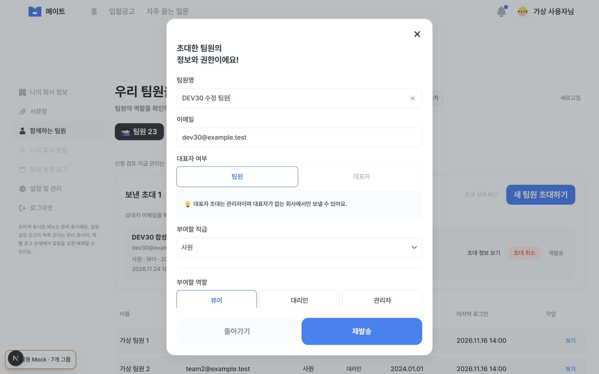
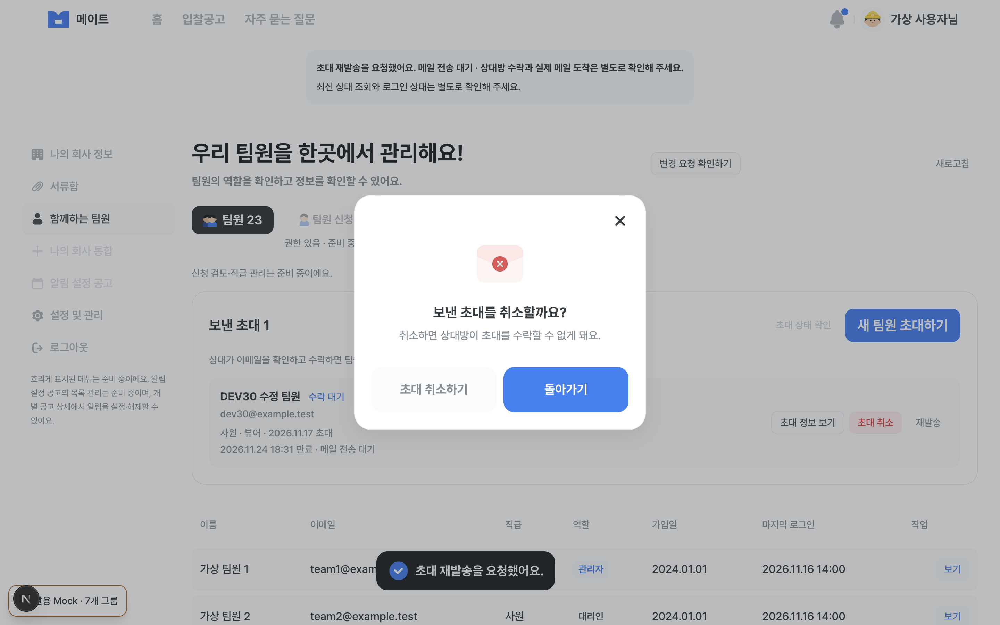

# DEV-30 · 기존 초대 편집·재발송·취소 검토

[WBS](../README.md) · [이번 Brief/D1/D2](../tasks/DEV-30.md#dev-30-brief) · [로컬 QA/실제 차단](../../../qa/team-members.md#dev-30-local-qa)

첫6절은 초기997 source의 primary 검토 이력이다. 독립 FAIL과 수정3/3 뒤의 유효한 primary 판정은 아래 ‘최종 primary ai-review’를 따른다.

## 1. 리뷰 요약

2026-11-17 primary ai-review: **로컬 승인 단위 PASS**. 사용자 D1의 로컬 선행·실제 QA 차단 보존과 D2의 편집/PATCH 포함을 기준으로 원래 요구사항·현재 package.json·status/diff/새 파일·관련 company 포트/화면/계약·검증 로그를 대조했다. 이메일/등록 이름 잠금·현재 leaf/grant/직급과 미만료 PENDING·version, PATCH 저장과 재발송/메일/수신 구분·부분 성공·명시 재조회·수명/중복을 확인했다. 실제 통합 PASS나 최종 Git 전달 완료 판정이 아니다. 독립 verifier는 아래에 별도로 기록한다.

## 2. 발견된 문제

미해결 Blocker/Major 없음. 초기 lint ref 경로 진단과 첫 테스트의 저장소 wrapper 가정은 교정됐고 최종997 tests/lint를 통과했다. 제품 자동 수정2/3을 보존한다. 공개 client·동일 company factory/7그룹·DTO 최소화/immutable snapshot/운영 guard·account namespace·기존 source/무관 변경 보존과 토큰/메일 원문 비저장·임의 cooldown/새 library 없음도 확인했다.

잔여 한계: 단말 시계는 서버 시계를 증명하지 않는다. mock 관리와 기존 수신 fixture는 독립이고 source/handoff 검사 열람·거부 응답 fetch 대역을 실제 취소 링크 수락 거부 통합으로 취급하지 않는다. Figma 두 frame·수정 popup의 크기/자산/흐름 대조는 전체 페이지/모든 상태의 pixel 전수 검증이 아니다.

## 3. 누락된 검증

실제 TEAM-14~17/23/26의6소유 부분은0통과6차단이다. 실행 중 process SHA·권한별 승인 합성 계정/회사·수신함·사용/소비/잔존/복구/담당 역할이 없어 업무 API·메일/실제 수신·수락은 실행하지 않았다. 이 단위의 D1으로 차단을 보존했으며 DEV-29나 다른 Task의 예외를 확대하지 않는다. 원격 최종 PR head CI/리뷰·정상 병합/main 동기화는 Git 전달 단계에서 별도로 확인한다.

검토한 명령/근거: Node22.20.0/pnpm11.3.0의 `pnpm test`997/997·`pnpm lint`0, 환경파일 제외 격리 실행의 동일 source API/mock/hybrid `pnpm --config.verify-deps-before-run=false build`·`build-storybook` PASS, 문서 검사·`git diff --check`, 실제 Next/Aside 합성 browser와 스크린샷/관찰 JSON. 관련 실행 파일10개 해시는 작업트리와 일치한다. package scripts를 새로 만들거나 test를 브라우저 테스트라고 부르지 않는다.

## 4. 문서 갱신 필요 여부

architecture/data-access·plan의 날짜별 근거, 개발/asset 안내·Task/WBS·QA/index와 이 review를 갱신했다. base/package/scripts·harness/config/agent/skill은 변경0으로 갱신하지 않는다. 반복/도구 경계 예방은 ai-failures에 한정 기록한다. 원본79/114Task/156의존·baseline/coverage/기존 정책·QA/차단은 보존한다. 상태는 WBS만 소유한다.

## 5. 개발자 확인 필요

현재 로컬 단위에 남은 제품/정책 blocking 결정 없음. D2의 PATCH 포함은 실제 사용자 답변이며 앞선 읽기 전용 가정을 대체한다. 실제 QA 재개 자원과 실행 범위는 별도 Gate다. 이번 Git 전달은 최초 요청으로 승인됐고 Chromatic 월간 한도 문제만 예외이며 보호 우회/강제 성공은 없다.

## 6. 추천 수정 방향

현재 로컬 변경은 독립 verifier와 최종 문서 freshness 확인 뒤 목적별 commit/PR·최종 head CI를 확인한다. 명령 성공을 실제 메일/수락으로 올리지 않으며, 다음 Task는 WBS 우선순위/선행 조건을 확인해 하나만 선정·인계한다. 이후 source/문서 변경 시 영향 검증·리뷰를 다시 수행한다.

## 초기 독립 verifier 전달 이력

당시 diff/새 파일·원본 요구사항과 로그를 read-only verifier에 전달했다. 이후 FAIL과 재검토는 아래에 보존한다.

## Context Audit Report

### 결론

PASS — 이번 영향 범위의 사실 불일치 없음. read-only audit 뒤 필요한 동기화만 위 Documentation Update Check 범위에서 수행했다.

### 확인한 코드베이스 사실

package.json의8scripts·pnpm11.3.0/lockfile9·Next16.2.9/React19.2.4/Vitest4.1.11, strict TS·기존 app/data/features/UI 구조와7개 source group/공개 client/server·config snapshot/운영 guard를 확인했다. 기본 실행 Node26과 별개로 검증은 pinned22.20.0을 명시했다.

### 문서별 정합성 점검

- base.md: scripts/package/버전·pin과 일치. 독립 type-check/format script 없음 유지.
- architecture.md: 기존 경로/토큰/포트를 유지하며 DEV-30의 form 재사용·취소 dialog·timer·수명을 사실 동기화했다.
- data-access.md: 같은 company 포트의 PATCH/resend/cancel·privacy/계정/부분 성공·mock 이력을 추가했다.7그룹/hybrid/immutable snapshot·fallback 없음/운영 guard는 변경하지 않았다.
- plan.md: 날짜별 DEV-30 연결만 추가. current/next/status는 WBS 한 곳에서 관리한다.79원본·114Task/156의존·TEAM26·기존 차단/이력 보존.
- harness.md: 실제3skills/verifier/config placeholder와 일치. 역할/sequence·등록 변경 없음.
- ai-failures.md: 실제 관찰된 lint/도구 출력 경계만 기록하며 없는 제품 장애나 정책을 만들지 않는다.

### 발견된 불일치

미해결 Major/Minor 사실 불일치 없음. 당시 DEV-29의 범위/검증과 현재 DEV-30 확장을 날짜별로 구분했다.

### 개발자 확인 필요 사항

실제 API QA 자원·변경/복구·실행 SHA는 별도 재개 Gate. 현재 계약/로컬 범위에 새 정책 결정 없음.

### 추천 수정 방향

이번 사실 동기화를 유지하고 status를 다른 문서의 현재 상태처럼 중복하지 않는다. 실제 자원 확보 후 원래 TEAM ID에서 별도 검증을 이어간다.

## PR 화면 근거와 복구

동일한 합성 회사/mock 계정의 전체 화면을 캡처해 native dialog와 주변 상태를 확인했다. Aside locator crop의 DPR/clip 오류가 있는 첫2이미지는 독립 Minor 뒤 올바른 전체 합성 화면으로 교체했다. 제품 구현에 스크린샷을 사용하는 것이 아니라 PR 시각 검토용 증거다. 취소 원본 icon은 별도 SVG80px이다.

QA 종료 시 task-local 합성 공간을 정리하고 소유 browser tab을 닫았다. task 소유 cwd를 확인한 Next listener1개를 정상 종료하고49191포트 반환을 확인했다. 실제 업무/API/메일·운영·배포는 실행하지 않았다. 이 복구/이미지 append는 제품 source 변경이 아니다.

## 초기 독립 verifier · FAIL 보존

- 초기997 자동 PASS/primary 검토와 별개로 독립 verifier가 **Major2/Minor1**을 재현했다. 토큰 대기 또는401 refresh 중 만료 뒤 실제 POST/재시도가 나가며 성공하는 경계, 기존 ADMIN grant 때문에 합법적 VIEWER 축소 편집창 진입이 차단되는 경계다. PR popup PNG2개의 잘못된 crop도 확인했다. 초기 PASS는 최종 판정으로 유효하지 않다.
- source 재현은 실제 feature/API/shared HTTP와 합성 fetch/계정/시계 조합이다. 토큰 대기 후 만료 POST1,401 최초 미만료 POST→만료 재시도 POST1을 확인했다. 다른 발견은 old-grant row guard 거부와 새 VIEWER 입력 plan 허용의 대조다. verifier의 코드/문서 수정0이다.
- 마지막 자동 수정3/3: optional 내부 `AuthAccess.assertRequestScope`를 최초/401 재시도의 실제 fetch 직전에 호출하고 만료/화면 수명을 검사한다. HTTP abort signal도 dispatch 전에 확인한다. 입력이 있는 편집 진입은 INVITE/미만료 상태, 새 grant/변경 leaf는 form·최신 scope/서버가 검사한다. 이미 발송된 요청의 서버 rollback을 보장하지 않는다. source/회귀·모든 검증·두 리뷰를 다시 수행하며 완료 전이다.

## 최종 primary ai-review · 2026-11-17

### 1. 리뷰 요약

**로컬 승인 단위 PASS**. 원래 요구사항/D1/D2·현재 status/diff/새 파일·package scripts·관련 소스/검증 로그를 재대조했다. 초기 독립 Major2/Minor1의 수정과 새 회귀를 포함한다. 실제 통합/Git 전달 판정과 구분한다.

### 2. 발견된 문제

미해결 Blocker/Major/Minor 없음. 명령 scope guard가 인증 대기/401 refresh 뒤 fetch 직전에도 만료·계정/epoch/Abort를 확인한다. 편집 진입에는 기본 권한, 제출에는 새 grant를 검사해 허용된 권한 축소를 보존한다. 기존7공급원/immutable snapshot·운영 guard·DTO/계정 namespace·새 library 없음과 원본 보존을 확인했다. 이미 전송한 서버 처리/단말·서버 시계 차이는 남은 한계이며 rollback 보장은 없다.

### 3. 누락된 검증

실제 TEAM-14~17/23/26은0통과6차단이다. 실제 메일/이전·취소 링크 수락/운영 변경0. 원격 최종 head CI/리뷰·병합/main 동기화는 전달 단계에서 확인한다. 현재 `pnpm test`1001/35files·lint0, 격리 동일 source API/mock/hybrid build·Storybook PASS와 실행 source11개 SHA256 일치를 확인했다. `test-revised.log`, `lint-revised.log`, `build-*-revised.log`, `storybook-revised.log`가 현재 근거다. 실제 Next/mock에서는 기존 ADMIN 초대를 VIEWER+INVITE+MANAGE actor가 VIEWER로 수정해 version3/delivery2로 재발송하는 DOM/JSON을 추가 확인했다. 추가 fullPage의 스티칭 중복 이미지는 시각 판정/PR에서 제외한다.

### 4. 문서 갱신 필요 여부

architecture/data-access에 선택적 HTTP guard와 편집 진입/새 grant 경계를 반영하고 QA·Task·WBS/review·ai-failures를 최신 검증으로 동기화했다. package/scripts·하네스/설정 변경0이므로 base/harness 추가 수정은 없다. 문서 링크/원본/ID·의존성·상태/Markdown·diff 검사를 재실행한다. 다음 선정·Git 사실 추가는 source 변경과 분리해 freshness를 확인한다.

### 5. 개발자 확인 필요

현재 로컬 범위에 새 정책/승인 차단 없음. 이번 Git 전달/Chromatic 한도 예외는 이번 사용자 최초 요청, 로컬 선행은 D1, PATCH 확장은 D2 근거다. 실제 QA 자원/실행 대응/복구 범위는 별도 재개 Gate이며 다음 Task를 시작하지 않는다.

### 6. 추천 수정 방향

현재 source를 고정하고 독립 verifier의 최종 문서 freshness를 확인한 뒤 목적별 commit/PR·최종 head CI·정상 merge/main FF를 진행한다. 문서만 추가하면 링크/상태/범위 보존을 다시 확인하고 source 검증은 변경 근거가 있을 때만 반복한다.

## 최종 독립 verifier · 2026-11-17

Result: **PASS**

Summary:
- D1 로컬 범위와 D2 PATCH 요구사항 충족. 초기 Major2/Minor1 해결, 실제 QA 차단 보존. 현재 scope guard의 최초/401 재시도 dispatch와 ADMIN→VIEWER 편집 진입/새 grant를 확인했다.

Issues:
- Blocker/Major/Minor: 없음. 단말/서버 시계 차이·이미 전송한 서버 rollback과 실제 메일/링크 수락은 보장하지 않는다.

Verification:
- 독립 실행: 동일 source 격리본 `pnpm test`35files·1001/1001, `pnpm lint`오류/경고0.
- 직접 대조: 실행 source11개 해시, 문서114Task/156의존/79ID/TEAM26/17links·Markdown·diff PASS. 수정 후 세 build/Storybook 성공 로그·회귀·기존/추가 browser JSON과 교체 PNG를 확인했다. build/browser는 독립 재실행하지 않고 동일 source 증거로 검토했다. 스티칭 오류 추가 이미지는 제외했다.

Documentation Update Check:
- Task/QA/review·WBS·architecture/data-access·ai-failures에3/3/초기 FAIL·최종 검증/한계, 기존 원본·정책/실제 차단 보존을 확인했다. 새 개발자 결정 없음.

Review freshness:
- `c0661b3` 위 검토한 source/test/docs/images diff만 해당한다. 이후 선정 인계·Git 사실 문서는 별도 freshness 확인 대상이다. verifier 수정0이다.

Developer follow-up:
- 다음 Task는 인계만 한다. 최종 PR head CI/병합/main 동기화와 실제6QA 차단은 별도다. 이 PASS는 Git 전달 완료가 아니다.

### 선정 인계 뒤 문서 freshness

read-only verifier 재검토 PASS: WBS 실집계38/23/50/1/2=114, DEV-30/31 원본 prefix·114/156/79/TEAM26/21links·Markdown/diff PASS. 검증된 source/test/SVG15파일 동일로 제품 검증은 재실행하지 않았다. 현재 문서까지 미해결 Blocker/Major/Minor0·verifier 수정0이다. 이 회신의 전사만 추가했으며 정책/범위/검증을 바꾸지 않아 회신 전사 자체는 독립 재실행하지 않는다. primary ai-review도 인계/판정표·집계·실제0/6차단·승인 비승계를 다시 확인했다. 이후 Git 사실은 별도 freshness 확인 대상이다.

### 커밋 직전 SVG 공백 정리의 freshness

새 SVG의 EOF 빈 줄1개를 staged diff-check에서 찾아 개행2→1로만 정리했다. XML serialization 동일(도형/속성 변화0)·staged diff-check PASS와 격리 자산 동기화를 확인했다. primary ai-review는 이 기계적 변경을 재검토했고, 앱 test/build·독립 source 전체 검증은 동작 변화0으로 재실행하지 않는다. 기존 PASS와 XML 동등성 근거를 함께 유지하며 실제 최종 PR head CI를 별도 확인한다.
