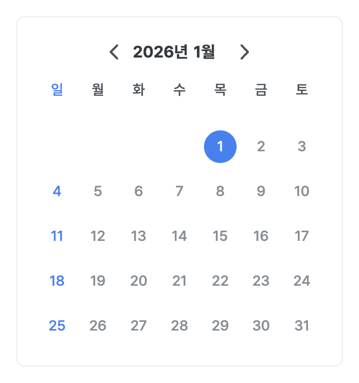
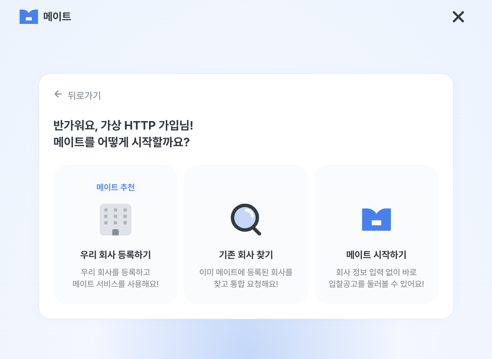

# DEV-57 · 검증과 Review Gate

- 요구사항/결정/착수 기준: [Task Brief](../tasks/DEV-57.md#dev-57-brief), [WBS](../README.md), [POL-29 후속](../tasks/POL-29.md#pol-29-decisions).
- 범위: 가입용 Figma Calendar/DatePicker·auth 프레임/입력/타일 정렬·nullable nickname 경계, 관련 테스트/문서. 사용자 D3의 **로컬 완료 범위**이며 실제 OAuth/가입/초대/회사 API·운영/배포는 제외한다.
- source/API: frontend 시작 `0db328011defc7fb0f5a77772d49327f44deb642`, backend dev `befe434c2b3fd80ddbc12c1d6216f738dd5ea12a`, 중앙 정책 `c9e50ff591ae18023164e1a94581c611bf1e4f29`. 게시 OpenAPI nickname string/null GET200을 확인했으며 실행 SHA/실제 인증 응답은 미확인이다. 초기 기본 UA403과 재조회200을 날짜별 관찰로 구분한다.

## 검증 근거

| 명령/방법 | 결과 | 범위/한계 |
| --- | --- | --- |
| Node22.20.0 `pnpm test` | PASS · 18파일/414건 | 날짜·nullable/누락·HTTP 타입 오류·mock 이름 저장 경계·기존 세션/계정/7그룹/guard/DTO/구조 회귀. 실제 서버 아님 |
| `pnpm lint` | PASS | 최종 label/초점 보강 포함 |
| `pnpm build` API/mock/hybrid | PASS ·3/3 | 환경파일 없는 격리 복사본, loopback 공개 API 주소, TypeScript·Next SSR/정적 생성. 최초 nullable 오류 뒤 재검증 |
| `pnpm build-storybook` | PASS | Calendar 7개 story 포함. 기존 extensionless/큰 chunk 경고는 유지. 이후 signup label만 보강되어 Storybook 소스/의존성/설정은 그대로이므로 중복 빌드 불필요 |
| 실제 Next/Storybook + Aside | [AUI-01~18](../../../qa/auth.md#dev-57-local-qa) | mock/로컬 HTTP 대역/혼합, desktop/390/320·키보드/초점·오류/충돌. 실제 API QA 아님 |
| 문서·원본/ID/상태·`git diff --check` | PASS · 종료 링크34개 | 원본79/114Task/156의존성·기존 QA/차단/정책 예외 유지 |
| `$context-audit` | [PASS](DEV-57-context-audit.md) | 영향 범위의 사실/문서 정합성. 출시/통합 판정 아님 |

- 교정 이력: 초기 빌드의 nullable SessionState 접근은 optional chain으로 수정했다. 브라우저 AX에서 이름/전화 label에 지우기 버튼 텍스트가 섞이는 기존 문제는 가입 폼의 명시적 label 연결/도움말/초점 테두리로 보강했다. 자동 교정2/3, 이후 최종 자동/빌드와 가입 재검증이 대상이다.
- 실제 API/소스/화면의 경계를 유지한다. 정식 약관·역할/회사 용어·DEV-56 헤더/DEV-58 홈과 기존 QA 차단은 해소하지 않았다.
- 재현 증거 경로는 auth QA를 따른다. 브라우저 도구의 일시적 selector/비동기 wait timeout은 fresh snapshot으로 상태를 확인했으며 성공으로 추정하지 않았다. Aside의 locator crop은 DPR clip이 어긋나 전체 viewport 캡처만 시각 근거로 사용했다.
- 브라우저 request listener/isolated-world observer는 navigation을 거친 payload를 포착하지 못했다. 이를 wire PASS로 사용하지 않으며 `browser-observer-unavailable.json`에 남겼다. 실제 Next의 날짜 선택 UI와 `tests/auth.test.ts`의 exact ISO birthDate/동의 code·version 요청 body 검증은 별도 근거다.

## 대표 결과

## Documentation Update Check

- base: script/package/실행 pin 변경 없음, 미갱신.
- architecture/data-access: Calendar·frame variant·nickname DTO/누락 호환·mock 메모리 경계를 갱신.
- plan: 날짜별 milestone/검증·실제 QA 경계만 추가하고 상태는 WBS에 유지.
- DESIGN: Calendar/DatePicker의 토큰/조작/기준 node/가입 경계를 기록.
- harness/ai-failures: 흐름/역할/도구 등록 변경 또는 새 반복 실패 없음, 미갱신. 단발 교정/재검증은 Task에 기록.
- WBS/Task/auth QA/POL-29 역링크: 이번 결정·체크포인트/검증·기존 차단 보존. coverage mapping/기준선/날짜별 감사는 변경하지 않는다.

## verifier

Result: **PASS** — `.codex/agents/verifier.toml`의 read-only verifier가 원래 요구사항/승인·현재 diff·소스·package scripts·검증 산출물로 독립 판단했다. 파일 수정 없음.

- Summary: 별도 Calendar/DatePicker·프레임별 폭·nullable nickname과 결측/지연/오류 처리가 승인된 로컬 요구사항을 충족한다. 실제 API QA 차단/정책·소유 경계 보존.
- Issues: Blocker 없음 / Major 없음 / Minor 없음. 실제 OAuth·가입·초대 API 통합과 실제 모바일 기기/Safari는 이번 PASS 밖이다.
- Verification: Node22.20.0 `pnpm test`18파일/414건·`pnpm lint`·`git diff --check` 독립 PASS. API/mock/hybrid 최종 빌드3/3 로그·14개 src 파일의 격리 복사본 일치, Storybook7 story·Figma/브라우저 캡처/AX·날짜/초점/모바일/오류 기록을 검토했다. WBS114/의존성156·활성 DEV-57 하나, 기준선/감사/coverage 불변·기존 auth QA prefix 보존도 독립 확인했다.
- Documentation Update Check: 필요한 사실/결정/검증 갱신과 공통 문서 미갱신 사유가 타당하다. 추가 제품/정책 결정 불필요, 종료/다음 선정/Git metadata는 후속 반영 대상이다.
- Review freshness: 검토한 src/tests 파일명·내용 SHA256 `0846c25726510adb8341151d18fabf3c09307fa35b5425ab748670718ea58cde`. 이 PASS는 검토한 diff에 한정되며 이후 변경은 재검토 또는 종료 metadata 한정의 구체적 생략 근거가 필요하다.
- Developer follow-up: 승인된 Git 전달 가능. 실제 QA는 실행 대응/합성 자원·사용/잔존/복구 범위 확보 뒤 기존 QA에서 재개한다.

## AI Review

### 1. 리뷰 요약

PASS — 원래 DEV-57/D1~D3·최종 `git status`, runtime/Calendar/tests diff, 관련 session/Repository·package scripts·자동/브라우저/문서 증거를 직접 검토했다. 승인된 로컬 단위의 요구사항을 충족하며 일반 기능 추가/다른 Task 실행/실제 QA로 확대하지 않는다.

### 2. 발견된 문제

현재 Blocker/Major/Minor 없음. nullable 타입 오류와 label AX 문제는 교정/재검증됐다. 기존 구조·Tailwind 토큰·공개 Repository/DTO·7그룹/guard·계정 격리·mock 이름의 메모리 한정·공용 UI/키보드/에러/권한 경계·안전한 next를 유지한다. package/secret/env 값·무관한 변경 없음. `$react-best-practices`로 훅·controlled 상태·focus/portal cleanup·접근성·타입을 점검했다.

### 3. 누락된 검증

로컬 필수 검증 누락 없음. 최종 label 보강 뒤 테스트/lint/구성 빌드·실제 Next 가입/날짜 Space/Enter/AX·초점과 문서 검증을 재확인했다. 실제 API 통합·서버 날짜 validation·실제 모바일 기기/Safari는 미실행/차단 보존하며 D3 밖으로 PASS를 확대하지 않는다. 브라우저 payload 미포착은 HTTP fetch 대역 assertion과 구분했다.

### 4. 문서 갱신 필요 여부

필요한 architecture/data-access·DESIGN/plan·Task/WBS/auth QA/POL-29 역링크와 context-audit 갱신 완료. 원본 기준선/79개 연결표/과거 감사·QA 판정/정책 예외를 보존했다. base/harness/ai-failures 미갱신 사유는 위와 같다. 완료/다음/Git metadata 뒤에는 해당 문서 검토를 갱신한다.

### 5. 개발자 확인 필요

이번 범위의 추가 확인 없음. D1/D2/D3·Git 전달·이번 Chromatic 월간 한도 예외는 확보했다. 실제 QA 재개 자원과 다른 Task의 미결은 그대로이며 이번 완료 조건으로 바꾸지 않는다.

### 6. 추천 수정 방향

추가 제품 수정 없이 종료 문서/다음 인계의 freshness를 확인하고 최종 PR head의 원격 CI·리뷰·정상 병합 조건으로 이력을 보존해 전달한다. Git 전달과 제품/실제 통합 판정은 별도로 보고한다.

## 종료 metadata freshness

- 첫 verifier/ai-review 뒤 변경은 검토 결과 인용·DEV-57 로컬 완료·POL-10 선정/첫 행동·Git 전달 계획뿐이다. 새 정책/제품/실제 QA·라이브러리 변경 없음. WBS는 완료23/차단23/대기65/준비1/보류2, 활성0이며 원본79/114Task/156의존성·과거 QA prefix/기준선/감사/coverage 불변을 다시 확인했다. 종료 문서 링크34개·Markdown/diff-check PASS.
- primary ai-review는 위6개 항목을 종료 문서 diff에 다시 적용했다. source/tests17개 내용 지문은 초기 검토와 같아 앱 test/lint/build·브라우저의 불필요한 반복은 하지 않는다. 별도 read-only verifier에는 이 종료 문서 변경만 추가 검토를 요청한다.
- 후속 verifier **PASS**: 종료4문서·D3 제한·POL-10 선정만/미착수·Git 미래 receipt 구분을 재검토했다. source/tests SHA256 `0846c25726510adb8341151d18fabf3c09307fa35b5425ab748670718ea58cde` 불변, WBS/선행/우선순위·문서34링크/원본·diff-check도 독립 확인했다. Blocker/Major/Minor 없음. 이 반환 결과를 충실히 인용하는 마지막 줄은 요구사항/코드/판정을 바꾸지 않으므로 primary 문서 검토·diff-check만 다시 확인하고 verifier/앱 검증의 재귀 실행은 생략한다. 범위/정책/소스가 바뀌면 해당 리뷰를 다시 수행한다.
