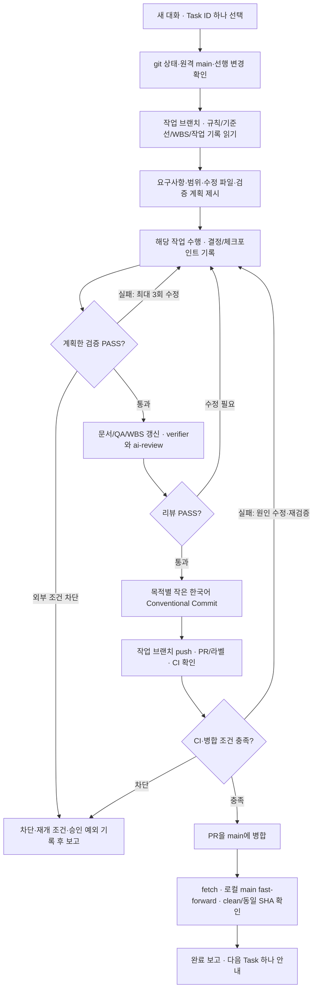

# Task 하나와 대화 하나의 개발·Git 전달 흐름

기본은 같은 프로젝트에서 Task 하나를 검증·리뷰하고 PR로 main에 반영한 뒤, 로컬 main을 동기화해 보고하는 흐름이다. 시작 프롬프트에서 [Git 전달 범위](start-prompt.md)까지 요청한 경우 아래 전체 순서를 적용한다. 실제 API/운영/배포 권한과 Git 전달 권한은 각각 확인한다.

## 시작할 때

- 최신 main과 현재 작업트리·선행 변경을 확인한다. 새 독립 기능은 main에서 작업 브랜치를 만든다. 선행 작업이 아직 main에 없으면 그 코드가 있는 브랜치에서 이어가는 안과 병합 순서를 먼저 정한다.
- 현재 대화의 승인 범위를 확인한다. 문서 Task는 문서만, 정책 Task는 결정 근거만, 검증 Task는 정의된 검증만 수행한다. 준비 상태가 미정 정책/실제 데이터 변경의 승인을 대신하지 않는다.
- 필요한 기준선·WBS·작업 기록·현행 소스만 읽는다. 조사 당시 HEAD와 현재 HEAD가 다르면 관련 변경을 확인한다.

## 끝낼 때

- 구현 코드 존재, 작업의 검증 PASS, 실제 API 통합 PASS, Git 전달 완료를 구분한다. 환경 차단/미실행은 그대로 남기며 승인된 예외를 다른 작업으로 확대하지 않는다.
- 수정 후 필요한 검증·리뷰를 다시 수행한다. WBS/작업 기록도 검토 대상이다. 커밋은 한 목적씩 나누고, PR은 프로젝트 템플릿과 적절한 라벨을 사용한다.
- push는 원격 작업 브랜치에 저장한 상태다. main 최신화까지 요청됐으면 PR·CI·병합을 마치고 로컬 main을 fast-forward로 맞춘다. 작은 커밋을 유지하려면 저장소 정책이 허용하는 merge 방법을 사용한다.
- 병합 직전 PR head와 최신 base·CI/리뷰 조건을 확인한다. main이 바뀌었으면 새 차이/충돌을 검토하고 영향 검증을 한다. force push·직접 main push·보호 규칙 우회로 해결하지 않는다.
- 최종 보고에는 PR URL, 커밋 요약, main의 로컬/원격 SHA 일치와 작업트리 상태, 검증/리뷰, 실제 API 대기·남은 차단, 다음 작업을 남긴다. 원격/환경 문제로 전달이 멈췄다면 검증 완료와 통합 대기를 구분해 보고한다.
- Task 단위와 브랜치/PR 단위가 항상 같을 필요는 없다. 연관된 선행 작업이 함께 완결돼야 하면 같은 기능 브랜치에서 Task별 대화/커밋을 이어가고, 중간 보고에는 main 미반영 사실을 명시한다.

## 현재 한 번만 하는 준비

2026-10-27의 기존 미커밋 변경 정리는 위 흐름을 시작하기 위한 별도 통합 작업이다. Repository 전환·테스트·CI·개발 문서·WBS를 검토해 목적별로 보존하며, PREP-01 또는 새 제품 기능을 실행하지 않는다. 이 준비의 검증/전달 결과는 [통합 검토 기록](reviews/main-integration.md)과 실제 PR/최종 보고에 남긴다.
