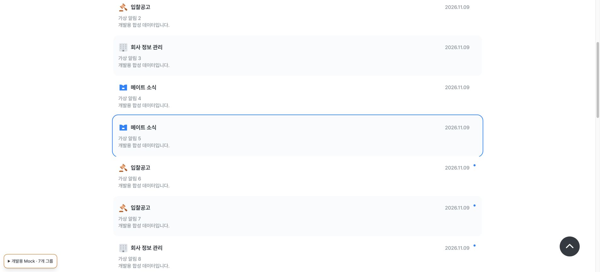
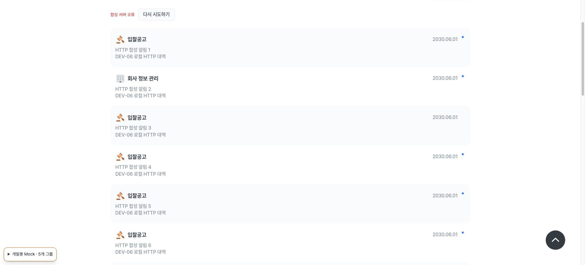

# 받은 알림 브라우저 통합 테스트

## 기준과 현재 상태

- Figma: [10_알림, 2304:29129](https://www.figma.com/design/Eayi1SWD8Xq8tGBmlp5SV2/%EB%A9%94%EC%9D%B4%ED%8A%B8-v0.1?node-id=2304-29129), [읽음 상태, 2304:89716](https://www.figma.com/design/Eayi1SWD8Xq8tGBmlp5SV2/%EB%A9%94%EC%9D%B4%ED%8A%B8-v0.1?node-id=2304-89716)
- 화면: `/alarms`, 헤더 알림 아이콘
- 실제 API: `GET /api/v1/me/notifications`, `GET /api/v1/me/notifications/unread-count`, `PATCH /api/v1/me/notifications/{notificationId}/read`
- 목록·건수·읽음 처리는 API에 연결했다. 항목 클릭은 읽음 처리 후 목록에 머물고, 20건을 넘으면 `더 보기`로 다음 페이지를 요청한다. 백엔드 `actionPath`에 따른 이동은 별도 작업이다.
- 사용자별 받은 알림 삭제 API가 없어 편집·삭제는 준비 중으로 비활성화했다. 공고별 알림 설정 해제 API는 받은 알림 삭제 API가 아니다.
- Figma에서 가려진 `7일 후 사라짐` 문구는 정책 미확정 참고사항이다. 화면에 표시하거나 자동 삭제를 구현하지 않는다.
- 2026-09-27의 개발용 Chromium 검사는 기존 mock 화면에서 7일 안내와 편집 버튼 상태만 확인한 기록이다. 아래 실제 API 검증과 구분한다.

## 실행 환경 기록

| 실행일시 | 프론트 URL·코드 상태 | 백엔드 URL·배포 | 브라우저·화면 | 테스트 계정·알림 상태 | 수행자 |
| --- | --- | --- | --- | --- | --- |
| 2026-09-28 약 08:00 KST | `https://local.mate-bid.com:3000`, 로컬 미커밋 코드 | `https://api-test.mate-bid.com`, 배포 식별자 미확인 | Safari 26.6.2 데스크톱, 캡처 3840×2100 | 기존 테스트 전용 계정, 받은 알림 없음; 별도 비공개 창은 로그아웃 | Codex |

Safari 웹 인스펙터의 네트워크 목록에서 테스트 API 서버로 세션 갱신, 알림 목록, 미확인 건수 요청을 확인했다. 민감한 요청 header·cookie는 기록하지 않았다. 목록 응답은 HTTP 200, `isSuccess=true`, `content=[]`, `totalElements=0`, `unreadCount=0`이고, 건수 응답은 HTTP 200, `isSuccess=true`, `data.unreadCount=0`임을 확인했다. 빈 상태가 나타났고 헤더 알림 점은 표시되지 않았다. 비공개 창에서는 로그인 안내와 `/auth?mode=login&next=%2Falarms` 이동을 확인했다. 이어 일반 Safari의 테스트 전용 계정에서 로그아웃 → 알림 페이지 안내 → Google 계정 선택 → `/alarms` 복귀와 빈 상태 표시를 끝까지 확인했다. 응답 본문 원문과 인증 정보는 저장하지 않았다.

## 남은 테스트 조건

- 읽지 않은 알림, 이미 읽은 알림, 알림 21건 이상이 있는 테스트 계정 또는 백엔드 담당자가 정한 생성 방법이 필요하다. 실제 알림 본문·계정 정보는 문서에 기록하지 않는다.
- `PATCH`는 서버의 읽음 상태를 바꾸므로 테스트 전용 알림으로 실행한다. 현재 사용자 결정에 따라 데이터가 준비될 때까지 실행하지 않는다.
- 공개 공고 데이터가 필요한 알림 생성이나 `actionPath` 이동은 테스트 공고와 프론트 경로 계약이 준비된 후 별도 기능으로 검증한다.

## 테스트 항목

### ALARM-01 — 실제 API의 빈 목록

- Figma node: [빈 상태, 2304:89973](https://www.figma.com/design/Eayi1SWD8Xq8tGBmlp5SV2/%EB%A9%94%EC%9D%B4%ED%8A%B8-v0.1?node-id=2304-89973)
- 화면 경로: `/alarms`
- API: `GET /api/v1/me/notifications?page=0&size=20&unreadOnly=false`
- 준비 데이터: 받은 알림이 없는 로그인 계정
- 조작: Safari에서 페이지를 열고 새로고침한다.
- 예상 결과: 실제 API 조회 뒤 빈 상태가 표시되고 과거 mock 알림이 나타나지 않는다.
- 상태: 통과 (2026-09-28)
- 환경/증거: 위 Safari 네트워크·응답의 빈 목록 요약과 빈 상태 화면·접근성 트리.
- 결함/담당자/재검증: 없음. 백엔드 배포 변경 시 재검증.

### ALARM-02 — 알림 없는 계정의 헤더 점

- Figma node: [10_알림, 2304:29129](https://www.figma.com/design/Eayi1SWD8Xq8tGBmlp5SV2/%EB%A9%94%EC%9D%B4%ED%8A%B8-v0.1?node-id=2304-29129)
- 화면 경로: `/alarms`의 공통 헤더
- API: `GET /api/v1/me/notifications/unread-count`
- 준비 데이터: ALARM-01과 같은 계정
- 조작: 로그인 상태에서 페이지를 열고 새로고침한다.
- 예상 결과: 건수 조회가 실행되고 미확인 알림 점이 나타나지 않는다.
- 상태: 통과 (2026-09-28)
- 환경/증거: 위 Safari 네트워크에서 HTTP 200·`isSuccess=true`·`unreadCount=0`, 목록의 `unreadCount=0`, 헤더 점 미표시 확인. 0건 응답끼리 대조함.
- 결함/담당자/재검증: 없음.

### ALARM-03 — 읽음 처리와 재진입

- Figma node: [읽음 상태, 2304:89716](https://www.figma.com/design/Eayi1SWD8Xq8tGBmlp5SV2/%EB%A9%94%EC%9D%B4%ED%8A%B8-v0.1?node-id=2304-89716)
- 화면 경로: `/alarms`
- API: `PATCH /api/v1/me/notifications/{notificationId}/read`, 이후 목록·미확인 건수 GET
- 준비 데이터: 읽지 않은 테스트 알림 한 건 이상
- 조작: 알림을 누르고 목록에 머무는지 확인한 뒤 새로고침한다.
- 예상 결과: 성공 응답 뒤 항목과 헤더 점이 갱신되고 재진입해도 읽음 상태가 유지된다. 실패 시 읽음으로 바뀌지 않고 오류가 보인다.
- 상태: 대기 (읽지 않은 테스트 알림 없음)
- 환경/증거: 미실행
- 결함/담당자/재검증: 테스트 알림 준비 후 실행

### ALARM-04 — 삭제 준비 중

- Figma node: [편집 상태, 2304:88975](https://www.figma.com/design/Eayi1SWD8Xq8tGBmlp5SV2/%EB%A9%94%EC%9D%B4%ED%8A%B8-v0.1?node-id=2304-88975)
- 화면 경로: `/alarms`
- API: 받은 알림 삭제 API 없음
- 준비 데이터: 알림 한 건 이상
- 조작: 편집 버튼의 상태를 확인한다.
- 예상 결과: 편집은 준비 중으로 비활성화되어 있으며 삭제 성공 안내가 나오지 않는다. 삭제/숨김 의미 확정 후 재설계한다.
- 상태: 차단 (받은 알림 삭제 API 누락)
- 환경/증거: 현재 빈 목록으로 버튼이 보이지 않아 실제 API 브라우저 시나리오 미실행
- 결함/담당자/재검증: 백엔드 API 계약과 알림 데이터 준비 후 재검증

### ALARM-05 — 7일 안내 보류

- Figma node: [10_알림, 2304:29129](https://www.figma.com/design/Eayi1SWD8Xq8tGBmlp5SV2/%EB%A9%94%EC%9D%B4%ED%8A%B8-v0.1?node-id=2304-29129)
- 화면 경로: `/alarms`
- API: 없음 (보존 기간 정책 미확정)
- 준비 데이터: 알림 한 건 이상
- 조작: 알림 목록 화면을 연다.
- 예상 결과: `7일 후 사라짐` 안내가 노출되지 않는다. 자동 삭제 여부는 검증 대상으로 간주하지 않는다.
- 상태: 대기 (실제 목록 데이터 없음; 2026-09-27 mock 화면에서는 안내 미노출 확인)
- 환경/증거: 실제 API 목록 화면 미실행
- 결함/담당자/재검증: 목록 데이터 준비 시 확인, 보존 정책 확정 시 재검토

### ALARM-06 — 알림이 있는 목록

- Figma node: [목록, 2304:29131](https://www.figma.com/design/Eayi1SWD8Xq8tGBmlp5SV2/%EB%A9%94%EC%9D%B4%ED%8A%B8-v0.1?node-id=2304-29131)
- 화면 경로: `/alarms`
- API: `GET /api/v1/me/notifications`
- 준비 데이터: 종류와 읽음 상태가 다른 테스트 알림
- 조작: 페이지를 열고 API의 제목·본문·시간·읽음 상태를 화면과 대조한다.
- 예상 결과: 서버 순서와 내용, 한국 시간 날짜, 종류별 아이콘, 미확인 점과 교차 배경이 일치하며 mock 항목이 나타나지 않는다.
- 상태: 대기 (테스트 알림 없음)
- 환경/증거: 미실행
- 결함/담당자/재검증: 테스트 알림 준비 후 실행

### ALARM-07 — 미확인 건수의 실제 값

- Figma node: [목록, 2304:29131](https://www.figma.com/design/Eayi1SWD8Xq8tGBmlp5SV2/%EB%A9%94%EC%9D%B4%ED%8A%B8-v0.1?node-id=2304-29131)
- 화면 경로: `/alarms`의 공통 헤더
- API: `GET /api/v1/me/notifications/unread-count`, `GET /api/v1/me/notifications`
- 준비 데이터: 미확인 알림 한 건 이상
- 조작: 두 API의 건수를 비밀값 제거 후 대조하고 다른 페이지로 이동했다가 돌아온다.
- 예상 결과: 두 `unreadCount`가 일치하고 헤더 점이 표시된다. 읽음 처리 성공 후 건수를 다시 조회한다.
- 상태: 대기 (미확인 테스트 알림 없음)
- 환경/증거: 미실행; ALARM-02에서는 두 API의 0건 응답을 대조함
- 결함/담당자/재검증: 테스트 알림 준비 후 실행

### ALARM-08 — 20건씩 더 보기

- Figma node: [목록, 2304:29131](https://www.figma.com/design/Eayi1SWD8Xq8tGBmlp5SV2/%EB%A9%94%EC%9D%B4%ED%8A%B8-v0.1?node-id=2304-29131)
- 화면 경로: `/alarms`
- API: `GET /api/v1/me/notifications?page=0&size=20`, 이후 `page=1&size=20`
- 준비 데이터: 순서가 구별되는 알림 21건 이상
- 조작: 첫 페이지의 `더 보기`를 누르고 연속 클릭·실패 후 재시도를 확인한다.
- 예상 결과: 기존 항목을 유지한 채 다음 항목이 순서대로 붙고 중복이 없으며 마지막 페이지에서 버튼이 사라진다.
- 상태: 대기 (21건 이상 테스트 알림 없음)
- 환경/증거: 미실행
- 결함/담당자/재검증: 테스트 알림 준비 후 실행

### ALARM-09 — 로그아웃 안내와 복귀

- Figma node: [로그인 안내, 2855:113653](https://www.figma.com/design/Eayi1SWD8Xq8tGBmlp5SV2/%EB%A9%94%EC%9D%B4%ED%8A%B8-v0.1?node-id=2855-113653)
- 화면 경로: `/alarms` → `/auth?mode=login&next=%2Falarms`
- API: 비로그인 세션 확인 `POST /api/v1/auth/token/refresh`; 알림 목록·건수 API는 호출하지 않음
- 준비 데이터: Safari 비공개 창의 비로그인 세션
- 조작: 로그아웃 상태에서 `/alarms`를 열고 로그인 안내 버튼을 누른 뒤, 테스트 계정으로 Google 로그인을 완료한다.
- 예상 결과: 안내가 보이고 로그인 화면에 `/alarms` 복귀 경로가 유지되며, 인증 완료 후 `/alarms` 화면으로 돌아온다.
- 상태: 통과 (2026-09-28)
- 환경/증거: 비공개 창의 안내·로그인 경로 확인 후 일반 Safari에서 테스트 전용 계정 로그아웃, 안내 CTA, Google 계정 선택, `/alarms` 빈 상태 복귀 확인. OAuth URL·계정 정보는 기록하지 않음.
- 결함/담당자/재검증: 없음

### ALARM-10 — 조회 실패와 재시도

- Figma node: API 오류 상태는 Figma에 별도 화면 없음
- 화면 경로: `/alarms`
- API: 목록 또는 미확인 건수 GET 실패
- 준비 데이터: 안전하게 재현할 수 있는 테스트 서버 오류 조건
- 조작: 목록 조회 실패 뒤 다시 시도 버튼을 누르고 정상 복구를 확인한다.
- 예상 결과: mock 목록으로 대체하지 않고 오류를 표시하며 재시도 성공 시 서버 목록을 표시한다. 건수 실패는 잘못된 미확인 점을 표시하지 않는다.
- 상태: 대기 (오류 재현 조건 없음)
- 환경/증거: 미실행
- 결함/담당자/재검증: 백엔드 담당자와 재현 조건 확정 후 실행

## QA-11 사전 점검 · 2026-11-05

[작업/재개 조건](../development/figma-v01/tasks/QA-11.md#qa-11-resume) · [검토 증거](../development/figma-v01/reviews/QA-11.md) · [현재/다음/상태는 WBS](../development/figma-v01/README.md).

사용자 답변 **“미준비 — 사전 점검·차단/재개 조건 문서화와 Git 전달만 진행 (추천)”**에 따라 소스·기존 QA·PREP 준비표만 대조했다. 실제 로그인/알림 GET/읽음 PATCH·알림 생성/배치·오류 주입·서버 시작/운영/배포를 실행하지 않았다. 이번 실제 실행 **0건·신규 통과0·재검증8차단**과 별도 ALARM-04 API 차단/ALARM-05 정책 보류를 구분한다. 위 기존 **3통과·1차단·6대기** 기록과 날짜별 근거를 수정하지 않았다. 현재 API의 알림이 0건임을 새로 확인한 결과가 아니다.

| 기존 case | 2026-11-05 사전 점검 판정 | 부족한 자원/재개 시 확인할 증거 |
| --- | --- | --- |
| ALARM-01 | 재검증 차단·기존 통과 보존 | 승인된 빈 disposable 계정/상태·GET 사용/실행 대응. 실제 목록0/건수0·빈 화면 대조 |
| ALARM-02 | 재검증 차단·기존 통과 보존 | 같은 계정의 목록/건수 GET·0건/헤더 점 없음 대조 |
| ALARM-03 | 차단·기존 대기 보존 | 미읽음 PATCH 대상·로그인/사용/변경/읽음 잔존·종료/복구 승인. 성공 후 점/건수·목록에 머묾·reload 유지·실패 시 값 유지·중복 요청 수 |
| ALARM-04 | 기존 삭제 API 차단 유지·미실행 | 받은 알림 삭제 계약은 별도 범위. 데이터 준비 시 비활성 편집 표시만 확인. 구독 해제를 삭제로 쓰지 않음 |
| ALARM-05 | 7일 정책 보류 유지·실제 목록 미실행·기존 대기 보존 | 데이터 준비 시 안내 미노출만 확인. 7일 보존/자동 삭제를 확정하거나 구현하지 않음 |
| ALARM-06 | 차단·기존 대기 보존 | 읽음/미읽음·여러 종류 합성 알림21건 이상·서버 순서/표시 기대값. DTO→KST/아이콘·점과 순번별 배경 구분 |
| ALARM-07 | 차단·기존 대기 보존 | 시작 총건수/unreadCount·읽음 PATCH 대상·종료 기대값. 목록과 건수 GET 일치·성공 후 재조회·마지막 미읽음 이후0/헤더 점 제거 |
| ALARM-08 | 차단·기존 대기 보존 | 21건 이상 별칭·첫20/다음/마지막 페이지·정렬 기대값, 연속 클릭·다음 페이지 실패/해제·재시도 수단. append/중복 없음·마지막 버튼 제거·기존 목록 유지 |
| ALARM-09 | 재검증 차단·기존 통과 보존 | 현재 disposable 계정 로그인/refresh/logout 사용 범위·Origin/실행 대응과 세션 종료 조건. 안내·복귀 경로 확인, 인증 query/계정 원문 기록 금지 |
| ALARM-10 | 차단·기존 대기 보존 | 최초 목록/건수 GET의 안전한 실제 서버 오류·상태/기간/해제·정상복구. fallback 없이 오류/재시도·잘못된 헤더 점 없음. 브라우저 차단은 네트워크 실패 증거로 분리 |

실행 환경: 시작 main=origin/main `0cf4aa8b741f80700de1c9852520492092bd1d98`·clean, fetch/FF 뒤 `docs/qa-11-alarms-preflight` 생성. 08:56 KST 기본 셸 Node26.5.0·pnpm11.3.0, 저장소/CI pin 및 로컬 실행 파일 Node22.20.0 확인, 3000/6006 TCP 리스너 없음. 브라우저/viewport·캡처/Network·현재 프론트 공급원 snapshot/backend 실행 대응은 미확보이며 문서 점검의 화면 증거는 해당 없음. `.env`/비밀값/개인정보를 읽거나 출력하지 않았다.

현재 소유 소스 대조: notifications 공개 client/contracts → HTTP/mock 경계, 페이지 size20·서버 순서·읽음 응답 검사·KST 표시, 읽음 성공 후 상태/건수 변경 이벤트, 헤더 재조회·실패/늦은 응답 분리, 로딩/재시도·중복 ID 제외 코드 확인. 코드 존재를 실제 동작 PASS로 세지 않는다. 기존 mock/HTTP 대역의25건/22미읽음·20→25/22→21과 [과거 RM-05](repositories.md)는 이번 재실행/실제 API 근거가 아니다.

재개 전에 합성 fixture·시작 총건수/미읽음/순서·PATCH 대상·사용/변경/잔존/종료/복구 담당/방법·안전한 오류와 해제·실행 식별자를 [QA-11 재개표](../development/figma-v01/tasks/QA-11.md#qa-11-resume)에 확보한다. 읽음 취소 API를 추정하지 않고 disposable 읽음 잔존 허용 또는 담당자 재생성/정리를 정한다. 담당자는 미지정이며 역할은 알림 fixture/API/배포 담당·개발자 승인자·프론트 QA 실행자다. 실제 데이터 변경이 없어 새 잔존/복구 대상 없음. 다음은 QA-11 재개이며 QA-12를 자동 시작하지 않는다.

### 2026-11-05 09:12 KST · 다음 Gate 선정에 한정한 후속 예외

사용자가 **QA-11 실제 QA 차단을 유지하고 QA-12를 다음 요구사항 Gate 대상으로만 선정하는 진행 예외**를 명시 승인했다. [승인 원문·범위·다음 첫 행동](../development/figma-v01/tasks/QA-11.md#qa-11-next-qa-12-exception)에 따라 앞선 ‘다음 QA-11 재개/QA-12 진행 예외 없음’은 당시 이력으로 보존하고 다음 선정만 대체한다. 실제 실행0건·신규 통과0·재검증8차단, ALARM-04 삭제 API 차단/ALARM-05 정책 보류, 기존3통과·1차단·6대기와 QA-11 재개 조건은 그대로다. 이번 후속도 앱/제품 API·설정 변경·알림 생성·서비스 운영/배포·QA-12 실행은 없다. QA-12의 실제 서버 오류·사용/변경/원복·실행 대응은 새 대화 Gate에서 확인하며 현재 준비 완료로 세지 않는다. 현재/다음/상태의 단일 기준은 WBS다.

## 2026-11-05 · POL-04 v1의 대상 화면 이동 QA 계획

[사용자3결정](../development/figma-v01/tasks/POL-04.md#pol-04-decisions)과 [DEV-06 인계](../development/figma-v01/tasks/DEV-06.md#pol-04-handoff)에 따른 **신규 ANAV-01~10 계획**이다. 이번에는 정책 문서만 작성했고 앱/브라우저·mock/HTTP 대역·실제 업무 API 실행0건, 신규 실제 통과0건이다. 10건 모두 **대기 — DEV-06 미구현·실제 자원/승인/실행 대응 미확보**이며 통과로 세지 않는다. 위 ALARM-01~10과 QA-11의 기존3통과·1차단·6대기/재검증8차단·04차단/05보류는 그대로다. 특히 ALARM-03의 ‘목록 유지’는 과거 읽음 구현의 기대값이고 새 허용 경로 이동의 PASS가 아니다.

아래 공통 기준은 모든 ANAV case에 적용한다.

- Figma node: [10_알림, 2304:29131](https://www.figma.com/design/Eayi1SWD8Xq8tGBmlp5SV2/?node-id=2304-29131), [읽음, 2304:89716](https://www.figma.com/design/Eayi1SWD8Xq8tGBmlp5SV2/?node-id=2304-89716). 경로/읽음 정책은 Figma만으로 추정하지 않고 POL-04 v1을 따른다.
- 출발 화면 `/alarms`; API N=`GET /api/v1/me/notifications`, C=`GET /api/v1/me/notifications/unread-count`, R=`PATCH /api/v1/me/notifications/{notificationId}/read`. 각 case의 N/C는 전후 상태 대조, R은 지정한 disposable 합성 알림에만 적용한다. 목적지 조회는 기존 공고 상세/회사 Repository를 사용하고 새 이동/권한 endpoint는 추정하지 않는다.
- 준비: 합성 전용 계정·알림/공고/분류/회사 별칭, 시작/종료 readAt·unreadCount/total/정렬/세션과 이동 기대값, 사용/변경·읽음 잔존 허용·복구 담당/방법, 안전한 오류/해제와 frontend/backend 실행 대응. 사용자 승인을 확보하기 전 실제 로그인/N/C/R·알림 생성/서비스 제어를 실행하지 않는다. 준비용 ID/경로 예시는 합성 값이며 실제 fixture 생성 증거가 아니다.
- 실행 시 기록: KST 시각·프론트 HEAD/공급원 snapshot/Origin·backend 배포 run/artifact와 실행 SHA 대응·브라우저/viewport·키보드·UI 캡처·비식별 method/path/status·시작/종료/복구. query/인증정보/알림 본문 원문은 저장하지 않는다. 서버 부재/장애를 조작하지 않고 승인된 오류 fixture를 사용한다.

| case | 화면·API | 준비 데이터·조작 | 예상 결과 | 이번 판정 |
| --- | --- | --- | --- | --- |
| ANAV-01 | `/alarms` → `/bids/{id}`(+선택 `bidClsfcNo`), N/C/R | 미읽음·공개 합성 공고와 복수 분류. 분류 없음/있음 알림을 각각 클릭하고 재진입 | R 성공 뒤 읽음/점·건수 반영 후 현재 탭 이동. 서버 snapshot의 대상/분류 유지·다른 ID 추정 없음. total/정렬 유지 | 대기·미실행 |
| ANAV-02 | `/alarms` → `/my/company`, N/C/R·기존 회사 조회 | 미읽음 회사 목적지, 연결/미연결·소속 변경된 계정별 fixture. 클릭 | query/hash 없는 정확한 경로, 현재 계정의 기존 회사/빈/권한 상태 표시. resourceId의 회사를 자동 열거나 가입하지 않음 | 대기·미실행 |
| ANAV-03 | 읽은 알림 → 허용 목적지, N/C·R 호출 없음 | 이미 읽은 공고/회사 알림을 클릭하고 목록 복귀 | PATCH 없이 검증 후 이동, 읽음 시각·건수 추가 감소 없음 | 대기·미실행 |
| ANAV-04 | `/alarms` 유지, N/C/R | null/빈/무효 타입·소식/회사 통합 등 미지원 경로, 읽음/미읽음 조합 클릭 | 미읽음은 R 성공 뒤만 반영. 모두 목록/본문 유지·안내, 원문 경로 출력/다른 목적지 추정 없음 | 대기·미실행 |
| ANAV-05 | `/alarms` 유지, N/C/R | 외부 및 같은 origin 절대 URL·scheme·`//`·역슬래시·공백/제어문자·경로 separator/이중 인코딩/dot segment·깨진 encoding의 합성 대역 입력 클릭 | 모든 우회 경로 거절. 외부/인증/API/변경 경로 이동0건. 허용된 N/C/R 외에 actionPath 위험 목적지로 보내는 요청0건. R 자체는 기존 읽음 성공 규칙 유지 | 대기·미실행 |
| ANAV-06 | `/alarms` → 허용 경로 또는 유지, N/C/R | 정상 분류 직렬화와 미지원/중복/빈 query·hash·잘못된/과대 ID, `/my/company?companyId=...`를 대조 | 정상 단일 분류만 유지, 현행 ID/분류 계약 외 값은 폴백. URL 파서 보정/반복 decode로 위험 입력을 허용하지 않음 | 대기·미실행 |
| ANAV-07 | `/alarms`, N/C/R | 읽음 네트워크·서버4xx/5xx·무효 응답 fixture, 실패 후 명시적 재시도/재조회 | 실패 시 이동/낙관 갱신 없음·기존 UI값과 오류 안내. 통신 실패의 서버 반영은 미확정으로 두고 재조회/멱등 재시도 후 맞춤. 중복 건수 감소/읽음 취소 추정 없음 | 대기·미실행 |
| ANAV-08 | `/alarms`, N/C/R·기존 세션 흐름 | 지연 응답·같은 항목 연속 클릭/서로 다른 항목 경쟁·해제·계정 교체·로그아웃·refresh 성공/최종401 | 중복 PATCH/이동 방지·늦은 응답의 새 계정/화면 이동0건. 기존 refresh1회/로그인 안내·`/alarms` 복귀, 로그인 후 자동 PATCH/이동0건 | 대기·미실행 |
| ANAV-09 | 허용 공고/회사 목적지·기존 조회·N/C/R | 정상 형식이나 삭제/공개 전/권한 거절/서버 오류인 합성 대상 클릭·복귀 | 허용 route의 기존 오류/빈/권한 UI. 읽음 성공 유지·다른 자원 우회/되돌림/추가 mutation 없음 | 대기·미실행 |
| ANAV-10 | `/alarms`와 허용 목적지·N/C/R | 위 정상/폴백/오류 fixture, 데스크톱·390/320px·Tab/Enter/Space·보조기술 상태 확인 | 포커스/버튼·로딩/오류/안내 접근성, 중복 행동 방지와 키보드 이동, 레이아웃/본문/순번 배경 유지 | 대기·미실행 |

backend source의 삭제 계약 관찰은 배포 완료가 아니며 ALARM-04의 날짜별 이력을 통과로 바꾸지 않는다. 삭제/보존은 POL-20/관련 개발, 변경 신호는 POL-05/DEV-07 범위다. 이 계획은 기존 QA 예외·실제 자원 준비·mutation 승인을 확대하지 않는다.

## 2026-11-09 · DEV-06 로컬 구현 검증

실행 ID `DEV06-20261109-local-01`. 기준 HEAD `8165cb9`의 `feat/dev-06-notification-navigation` + DEV-06 diff. 사용자가 **“미준비 — 로컬 구현·검증 진행, 실제 통합 차단 보존 (추천)”**을 선택했다. 아래는 Node 계약·mock/HTTP 대역·로컬 Chrome 결과다. **실제 로그인/업무 API 실행0건, ANAV-01~10 실제 통합 0통과·10차단**이다. 위 2026-11-05 계획/기존 ALARM-01~10·QA-11의 과거 판정과 예외는 그대로 보존한다.

### 환경과 실행 경계

- Node22.20.0 / pnpm11.3.0 / Next16.2.9. localhost `http://127.0.0.1:4306`, Chrome 전용 임시 탭. Aside profile은 연결되지 않아 CUA로 검증했다. mock 브라우저 기본 desktop 및 viewport390×844/320×844. 기본 desktop 크기를 별도 고정하지 않았다.
- full mock snapshot: preview / 7그룹 mock / 기본 시나리오. API 공개 주소는 별도 localhost4399 대역으로 명시했다. HTTP 대역 snapshot: hybrid / auth·notifications만 api, bids·company·bidAlerts·personalFilters·notificationSettings는 mock. 그룹/제약을 추가하거나 실제 ID를 합성 ID로 치환하지 않았다.
- 4399는 프로세스 메모리 안의 합성 응답 서버다. 실제 API·계정·cookie·메일·공고/회사 변경이 없고 입력/출력에는 합성 데이터만 사용했다. 이 환경은 실제 배포/CORS·backend 계약 검증이 아니다.
- full mock 브라우저 관측129요청 중 외부 HTTP0 / API·OAuth·upload0. 별도 origin 없는 cursor 이미지2요청은 브라우저 제어 자산으로 구분했다. mock build/start의 Node fetch guard가 Next telemetry12시도를 차단했으며 업무 API/OAuth/첨부·업로드 시도는0이었다. 따라서 전체 fetch **시도**0이라고 쓰지 않는다. HTTP 대역 관측101요청은4306/4399 안에 한정, 외부 HTTP0·이벤트 누락/잘림 없음.
- 비밀값·실제 환경파일·실제 인증 query/응답 원문은 기록하지 않았다. 로컬 실행 과정의 자동 환경 로딩과 환경파일을 직접 읽는 행위를 구분한다.

### ANAV별 로컬 증거와 미실행 실제 통합

| case | Node / mock / HTTP 대역 확인 | 실제 통합 |
| --- | --- | --- |
| ANAV-01 | mock 알림1 → `/bids/10001`,22→21; 알림2 → `/bids/10002?bidClsfcNo=2`,21→20·분류2 표시. 상세 hard reload도 유지. HTTP 응답 목적지 snapshot을 사용하고 resourceId99999로 추정하지 않는 계약 테스트 | 차단 — 실제 합성 공고/복수 분류·배포 대응 미확보 |
| ANAV-02 | mock 알림3 Space → 정확한 `/my/company`·현재 계정 미연결 화면,20→19. HTTP 알림8도 같은 화면. 임의 회사 ID/query 없음 | 차단 — 실제 연결/미연결·소속 변경/권한 fixture 미확보. 로컬 확인도 미연결 분기에 한정 |
| ANAV-03 | mock 알림1 재클릭/Enter 시21유지. HTTP 이미 읽음 알림3 → 분류2,17유지·PATCH 기록 없음. Node PATCH/읽음 반영 spy0 | 차단 — 실제 읽은 알림 fixture 미확보 |
| ANAV-04 | mock null/미지원 알림4/5 각각 읽음 뒤 목록/본문·안내,19→18→17. 이미 읽은4 재클릭 건수 유지. 옛 탭의 누락/위험 경로는 null로 보완하며 이력 보존 테스트 | 차단 — 실제 null/미지원 fixture 미확보 |
| ANAV-05 | Node 외부/같은origin 절대URL·scheme·역슬래시·dot segment·중복 인코딩·깨진 UTF-8·C0/C1/Unicode format 거절. HTTP 알림5의 외부 경로도 경계에서 null, 목록/안내·추가 이동 없음 | 차단 — 실제 경계 fixture/사용 승인 미확보 |
| ANAV-06 | Node safe integer·50자·단일 query·한글/정상 `%26/%3D/%2B` 직렬화, 무효ID/중복/빈/미지원 query·hash 거절. mock/HTTP 분류2 URL 확인 | 차단 — 실제 분류 계약/실행 대응 미확보 |
| ANAV-07 | HTTP 알림6 첫503:미읽음/21유지·오류, 명시 재시도 성공 뒤20·폴백. 알림9의 무효 read 응답은19유지·오류. Node에서 서버 반영 뒤 연결 단절 → UI 무갱신/무이동 → 명시 멱등 재시도 후1회 반영·이동 | 차단 — 실제 안전한 실패/잔존·복구 fixture/승인 미확보 |
| ANAV-08 | HTTP 알림7 double click:aria-busy true/disabled·PATCH1회. 이어8 클릭 시8의 회사만 이동,7의 늦은 완료 뒤 회사 URL 유지. 알림10은 PATCH401→refresh1회→PATCH성공.11은 최종401 뒤 `/alarms` 로그인 안내·복귀next=/alarms·재인증 뒤11자동PATCH0. 지연7 처리 중 로그아웃 뒤 늦은 이동0/익명 유지. Node 계정 교체/해제·오래된 실패/이동 경쟁 검증. mock 계정1의17건·계정2의22건 격리/복원 | 차단 — 실제 계정/401·안전한 해제와 실행 대응 미확보 |
| ANAV-09 | HTTP 알림12 → mock `/bids/99999`의 기존404,16건·읽음 유지 후 목록 복귀. 목적지 선행 GET/다른 ID 우회·읽음 rollback 없음 | 차단 — 실제 삭제/공개 전/권한/서버 오류 fixture 미확보. 로컬 목적지 검증은404·회사 미연결 분기에 한정 |
| ANAV-10 | 390/320px 가로 넘침 없음, 순번 배경/본문 유지. Enter·Space 이동, Tab 다음 항목의 focus outline, button/busy/disabled·status/alert AX 확인. VoiceOver 실기는 미실행 | 차단 — 실제 통합 자원 미확보. AX 확인을 실제 보조기술 사용으로 확대하지 않음 |

HTTP 대역 종료 전 total25·unread21→15, PATCH 시도:50005=1/50006=2(503+명시 재시도)/50007=1/50008=1/50009=1(무효 응답)/50010=2(401+refresh)/50011=1(최종401)/50012=1. 이미 읽은50003의 PATCH0. 전체 refresh3회(시작1·동일계정 재시도1·최종만료1). reset 후 재인증으로50011 자동 재생0을 확인했다. 별도 지연 로그아웃 검증에서 서버는 읽음을 뒤늦게 반영(unread20)했으나 UI는 익명/목록 유지했다. 통신 실패나 로그아웃이 서버 반영 취소를 보장한다고 주장하지 않는다.

### 실행 명령과 종료

| 검사 | 결과 |
| --- | --- |
| `pnpm test` | 11파일167건 PASS. 최초 fixture 기본 인자 때문에1건 실패 후 재통과. 리뷰의 늦은 실패2case/증거 확장자 보완 포함 자동 수정2/3 |
| `pnpm lint` | PASS·경고/오류0. 최초 fixture 미사용 변수 경고는 정리 후 재통과 |
| `MATE_APP_ENV=preview MATE_DATA_PROFILE=api pnpm build` | 최신 코드 PASS. API 주소를 localhost 대역으로 명시, 실제 API 통합 검증 아님 |
| `MATE_APP_ENV=preview MATE_DATA_PROFILE=mock pnpm build` | 최신 코드 PASS·7그룹 mock. Next telemetry 차단과 업무 요청0을 구분 |
| `MATE_APP_ENV=preview MATE_DATA_PROFILE=hybrid pnpm build` | PASS·위 auth/notifications HTTP 대역 + 나머지 mock 구성 |
| `pnpm build-storybook` | PASS. 큰 chunk 관련 비차단 안내만 있음 |
| hybrid Preview 산출물을 production으로 `pnpm start --port 4308` | 예상 거절 PASS: 실제 exit1·운영 mock 거절 문구, 서버 지속 실행 없음 |
| `git diff --check` / 문서 링크·79 ID·99 Task·상태/선행·기준선 무결성 | 최종 결과는 [DEV-06 검토 기록](../development/figma-v01/reviews/DEV-06.md) 참조 |

실행 로그·비식별 Network 요약은 이 Mac의 `/tmp/mate-dev-06-qa/` 및 `/tmp/dev-06-*.log`에 임시 보존한다. 다른 환경의 영구 재현 근거는 이 문서·테스트·스크린샷과 PR의 실제 CI다. 브라우저는 로그아웃 후 임시 탭 종료·viewport reset. 소유 localhost 프로세스 종료/포트 반환은 Task 종료 체크포인트에서 확인한다.

### 실제 통합 재개 조건

backend 계약/배포 담당과 합성 자원·복구 담당 역할이 다음을 제공해야 한다. 개인 담당자는 미지정이다.

1. 비밀값 없는 배포 OpenAPI/schema snapshot·version/내용 지문, frontend/backend 실행 SHA 또는 run/artifact 대응.
2. disposable 합성 계정·알림/공고/분류/회사와 null/위험/미지원/없는·권한 대상, 시작/종료 readAt·unread/total/정렬·세션 기대값.
3. 로그인/N/C/R 사용·변경·읽음 잔존 허용과 복구 담당/방법, 안전한 실패/401 재현·해제 범위의 명시 승인.
4. 최신 소스/Git/공급원 snapshot을 확인한 뒤 ANAV-01~10 실제 실행·두 리뷰. 기존 QA-11/ALARM 차단과 타 Task 예외를 이 로컬 검증으로 해소하지 않는다.

## 2026-11-09 · POL-05 변경 신호/REST 재동기화 계획（미실행）

정책: [POL-05 v1](../development/figma-v01/tasks/POL-05.md#pol-05-contract), 배포/자원/승인: [필수 재개 조건](../development/figma-v01/tasks/POL-05.md#pol-05-handoff). 사용자 답변은 **소스 정책 확정만** 승인했으며 실제 자원은 미준비다. 아래 신규12case는 **실제0통과·12차단·실행0건**인 계획이다. mock/HTTP/transport 대역 검증도 이번에는 실행하지 않았다. 기존 ALARM-01~10·QA-11·ANAV-01~10/DEV-06의 날짜별 통과/대기/차단·예외를 보존한다.

공통 Figma node: [2304:29131](https://www.figma.com/design/Eayi1SWD8Xq8tGBmlp5SV2/?node-id=2304-29131), 화면: 전역 Bell·`/alarms`. W=`/ws/v1/notifications` native WS handshake + STOMP CONNECT/`/user/queue/notification-changes` SUBSCRIBE, C=`GET /api/v1/me/notifications/unread-count`, N=`GET /api/v1/me/notifications?page=p&size=20&unreadOnly=false`, R=`PATCH /api/v1/me/notifications/{notificationId}/read`. 이 약어는 HTTP 실행의 증거가 아니다.

| case | 경로/API·준비 데이터·조작 | 기대 UI/계약 결과 | 이번 실제 판정/차단 |
| --- | --- | --- | --- |
| NSIG-01 | Bell·목록 / W,C,N. 합성2계정·허용/거절 Origin, 배포 WS/REST version/실행 대응. 로그인 후 upgrade/CONNECT/구독 성립 확인, 다른 destination/SEND와 미인증 시도는 승인된 fixture에서만 수행 | 인증 계정의 단일 고정 queue만 허용. token/query/log·타계정 payload 노출 없음. 다른 화면 C만, 목록 진입 N; 구독 완료 뒤 REST 재동기화로 최초 GET→구독 사이 유실 보완 | 차단·미실행 — 배포/Origin·합성 계정·허용 시도/복구 미확보 |
| NSIG-02 | Bell·목록 / W,C,N. 계정 A에 승인된 합성 알림1건 생성, B는 무관. 변경 전후 count/total·정렬 snapshot 확인 | type만 신호로 받고 C/필요 N 재조회. payload로 카드/건수 증감·알림 생성 없음. B와 비인증 탭에 A 상태를 적용하지 않음 | 차단·미실행 — 합성 생성/잔존·복구·기대값 미확보 |
| NSIG-03 | Bell·목록 / W,C,N. fake Clock/transport와 실제 안전한 신호 fixture에서 동일/연속/무효 type·burst를 주입하고 요청 시각/동시성 관찰 | 첫 신호500ms 고정 창·같은 계정 시작 간 최소1초/동시1묶음. 진행 중 신호는 후속1묶음, 무제한 queue/계속 밀리는 debounce 없음. 무효 신호 무시·주기 polling0 | 차단·미실행 — 실제 신호 주입 범위·시각/복구 자원 미확보 |
| NSIG-04 | `/alarms` / W,C,N. 합성25건 이상에서20→40건 범위까지 펼치고 스크롤/포커스 위치를 기록한 뒤 새 신호. 정지/동시 INSERT fixture를 분리 | 펼친 유효 page 범위 재조회·서버 순서/ID 중복 제거·스크롤 유지. 첫20/상단 강제 초기화 없음. 부분 page 실패는 기존 목록 보존. totalPages 축소·offset 경합/후속 수렴을 구분하고 원자적 snapshot/무누락을 과장하지 않음 | 차단·미실행 — 복수 페이지/변동 fixture·합성 상태 미확보 |
| NSIG-05 | Bell·목록 / W,C,N. 읽지 않은 알림·시작 상태 준비 후 브라우저 offline/online, 숨김/복귀·focus/online 동시 발생·재연결 | 중단 중 소켓/진행 요청/예약 timer 정리·늦은 응답 무시. 다시 visible+online+인증일 때 연결/구독·REST 갱신. 중복 복귀는 합쳐 동일 간격, 기존 데이터 보존·정기 polling 없음 | 차단·미실행 — 계정/복귀 전후 기대값·승인된 관측 자원 미확보 |
| NSIG-06 | Bell·목록 / W,C,N. fake Clock에서 연결 실패 반복, 실제는 승인된 연결 실패/해제 fixture | 기준1/2/4/8/16/30초 cap+지터·단일 재연결. 숨김/오프라인/비인증 예약0, 인증/구독 성공 후 초기화. WS 실패에도 REST/명시 재시도 가능·mock fallback 없음 | 차단·미실행 — 안전한 연결 실패/해제·배포 지원 미확보 |
| NSIG-07 | Bell·목록 / W,C,N. 합성 계정의 token 갱신/만료·CONNECT 인증 거절·최종 실패/Origin 오류 fixture | 최신 token으로 연결 교체·재구독·동기화. 동일 계정 refresh 공유/한번 재시도 후 최종 인증 실패에 연결/예약 종료. 모든 ERROR를401로 추측하지 않음. 인증값·frame 원문 저장 없음 | 차단·미실행 — 인증/오류·세션 기대값·복구 범위 미확보 |
| NSIG-08 | Bell·목록 / W,C,N. A의 늦은 CONNECT/신호/REST를 지연시켜 logout·B교체·동일 A재로그인·화면/shell 해제를 각각 수행 | 종료 수명 무효화가 우선. unsubscribe/disconnect/abort/timer/listener 정리, 새 계정/새 로그인에 옛 이벤트 적용0. 목록 해제는 소비자만 정리, 전역 수명 종료는 소켓 정리 | 차단·미실행 — 합성2계정·안전한 지연·잔존/복구 미확보 |
| NSIG-09 | `/alarms` / W,C,N,R. 읽음/더 보기 진행 중 신호·중복 클릭·늦은 GET. 합성 알림 readAt/unread/total·목적지 준비 | 이전 GET로 읽음/건수 롤백 없음, 더 보기/재동기화가 이전 page를 혼합하지 않음. 로컬 이벤트와 원격 신호를 합치되 읽음 PATCH/이동은 재생하지 않음. 기존 POL-04·ANAV 회귀, C/N 별도 응답 시점·후속 동기화 확인 | 차단·미실행 — read 변경/잔존·목적지·경쟁 fixture 미확보 |
| NSIG-10 | Bell·목록 / W,C,N. C만/N 한 page만 실패·5xx/지연·정상 복구 fixture와 listener만 degraded인 신호 유실 구간 | 성공 데이터 보존·오류/명시 재시도. 건수 실패를0으로 표시하지 않으며 실패만으로 즉시 무한 재조회 없음. listener 유실은 재연결/복귀/명시 재조회로 복구, polling 없는 동안 자동 최신성 SLA 보장 없음 | 차단·미실행 — 승인된 안전 오류·listener/복구 자원 미확보. 운영 장애 조작 없음 |
| NSIG-11 | 같은/다른 계정2탭 / W,C,N,R. 한 탭에서 허용 합성 읽음 후 다른 보이는 탭과 숨김 탭 복귀 확인 | 같은 계정의 각 활성 연결이 신호→REST로 수렴, 다른 계정 격리. 이미 읽음 반복이 중복 사건/추가 감소를 만들지 않음. 숨김 탭은 복귀 때 수렴, 탭 간 leader election 요구 없음 | 차단·미실행 — 다중 탭·read 잔존/복구·실행 대응 미확보 |
| NSIG-12 | Bell·`/alarms` / 공급원별 대역 및 W,C,N. mock/API/허용 hybrid, auth=api+notifications=mock·계정 교체/페이지 해제, 데스크톱·390/320px·키보드 재시도 | 동일 정책/정리·token/계정 격리. mock 알림은 실제 WS/REST/추가 token 요청0·실제 ID 치환 없음·공급원 runtime 전환 없음. 모바일/키보드 오류·재시도/포커스·스크롤 확인. 실제 통합과 대역 증거를 분리 | 차단·미실행 — DEV-07 미구현/실행 환경·자원 미준비 |

실행 전 frontend HEAD/공급원 snapshot/Origin·backend 배포 run/artifact→실행 SHA·WS/STOMP/REST version·브라우저/viewport·시각·합성 기대값·사용/변경/이력 잔존/복구 승인·오류 해제를 확보한다. 증거는 요청 종류/경로·상태·상대 시각/요청 수·비식별 UI 결과로 제한하며 token/cookie/CONNECT frame·계정 ID·개인 알림 본문/목적지 원문·실제 `.env` 값은 기록하지 않는다. 서버 신호 생성/읽음 mutation은 별도 승인된 합성 범위에서만 수행한다. 각 case의 실제 결과는 DEV-07 재개 후 별도 실행 ID로 기록한다.

## 2026-11-12 · DEV-62 안내 교정

- 상단의 삭제 API 부재·목록 유지 설명과 기존 case/상태는 당시 이력으로 보존한다. 현행 backend dev `4c328d4`에는 삭제 POST가 있으며 POL-20 정책·DEV-43 프론트 연결은 별개다. DEV-62에서는 API 부재 안내를 제거하고 편집 미지원 사유를 화면/ARIA에 표시했다.
- POL-04/DEV-06의 읽음 성공 뒤 허용 경로 이동·null/위험 fallback을 DESIGN에 동기화했다. 이 문구 검증으로 기존 실제 재검증8차단·ALARM-04/05 이력이나 ANAV10차단을 통과로 바꾸지 않는다.
- 이번 근거는 [알림 안내 로컬 검증](notification-guidance.md)과 [DEV-62](../development/figma-v01/tasks/DEV-62.md)에서 확인한다. 기존 실제 API 결과·미실행/차단을 보존한다.
