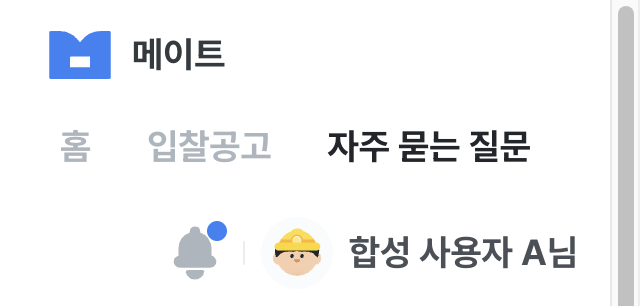

# 설정 및 관리 첫 화면 브라우저 통합 테스트

## 기준

- Figma 파일/화면: [9.0.0 설정 및 관리, 3139:52490](https://www.figma.com/design/Eayi1SWD8Xq8tGBmlp5SV2/%EB%A9%94%EC%9D%B4%ED%8A%B8-v0.0?node-id=3139-52490)
- 구현 화면: `/my`; 연결 확인 대상 `/my/company`, `/my/settings/notifications`, `/auth?mode=login&next=%2Fmy`
- 관련 API: `POST /api/v1/auth/token/refresh`, `POST /api/v1/auth/logout`, `GET /api/v1/me/notification-email-settings`, `GET /api/v1/me/matched-bid-notice-email-settings`
- 이번 작업의 정적 검증: Node 22.20.0에서 `pnpm lint`, `pnpm build`, `git diff --check` 통과
- 실제 브라우저 통합 상태: `2026-09-28 당시 7건 통과`; 회사 메뉴 활성화 후 MSET-02 재확인 대기

## 실행 환경 기록

| 실행일시 | 프론트 URL·배포/commit | 백엔드 URL·배포 | 브라우저·화면 크기 | 테스트 계정/데이터 별칭 | 수행자 |
| --- | --- | --- | --- | --- | --- |
| 2026-09-28 13:30~13:40 KST | `https://local.mate-bid.com:3000`, 작업 트리 `71a1099` 기반 | `https://api-test.mate-bid.com`, 배포 식별자 미확인 | Chrome, 1920px·390×844·320×700 | 기존 Mate 테스트 계정, 회사 미가입 | Codex |

## 선행 조건·범위

- 로컬 HTTPS 인증서와 백엔드 허용 Origin, Google OAuth 반환 설정이 준비된 환경이다. 공개 Vercel 테스트 사이트는 이번 검증 범위에 포함하지 않았다.
- 회사 메뉴는 `/my/company`로 이동한다. 계정 관리, 서비스 이용안내, 의견 보내기는 `준비 중`으로 비활성 표시한다. `/my` 첫 화면 자체에서는 회사명이나 회사 데이터를 조회하지 않는다.
- `/my` 자체의 새 데이터 조회 API는 없다. 세션 확인 API와 이미 구현된 알림 설정 화면으로의 이동을 실제 백엔드와 검증했다.
- 브라우저에서 화면 캡처를 확인하고 Network 이벤트의 경로·HTTP 상태만 기록했다. 이메일, access token, 쿠키, 응답 본문은 보관하지 않았다.

## 테스트 항목

### MSET-01 — 로그인 상태의 첫 화면

- Figma node: `3139:52490`
- 화면 경로: `/my`
- API: `POST /api/v1/auth/token/refresh`
- 준비 데이터: 기존 Mate 테스트 계정 로그인 세션
- 조작: `/my`를 열고 새로고침한다.
- 예상 결과: 세션 API 200 후 제목·메뉴 6개·카드 3개·의견 배너가 표시된다. 회사명은 임의로 만들지 않는다.
- 상태: `통과`
- 환경/증거: Chrome 1920px, refresh 200. 제목 `x378/y94`, 카드 `x370/y214`, 배너 `x370/y438`로 Figma의 주요 위치와 일치했다.

### MSET-02 — 회사 메뉴 활성화와 미구현 항목 비활성

- Figma node: `3139:52490`
- 화면 경로: `/my`
- API: `없음`
- 준비 데이터: 로그인 세션
- 조작: 회사 메뉴·나머지 미구현 메뉴·계정 관리·서비스 이용안내·의견 보내기 상태를 확인하고 회사 메뉴를 누른다.
- 예상 결과: 회사 메뉴는 `/my/company`로 이동한다. 미구현 메뉴 3개와 의견 보내기 버튼은 disabled이며, 두 카드는 링크가 아니라 `준비 중` 안내를 표시한다.
- 상태: `대기` (회사 메뉴 활성화 이후 재확인 필요)
- 환경/증거: 2026-09-28의 기존 코드에서는 회사 메뉴를 포함한 4개가 disabled였다. 당시 통과 결과는 현재 기대값의 증거로 사용하지 않는다.

### MSET-03 — 알림 설정 카드 이동

- Figma node: `3139:52510`
- 화면 경로: `/my` → `/my/settings/notifications` → `/my`
- API: `GET /api/v1/me/notification-email-settings`, `GET /api/v1/me/matched-bid-notice-email-settings`
- 준비 데이터: 로그인 세션과 기존 설정
- 조작: 알림 설정 카드를 누르고, 해당 화면의 마이페이지 breadcrumb로 돌아온다.
- 예상 결과: 설정 화면으로 이동해 두 조회 API가 200으로 응답하며 `/my` 복귀가 동작한다.
- 상태: `통과`
- 환경/증거: Chrome URL 이동 및 두 GET 200 확인. React 개발 모드의 중복 GET은 같은 결과로 관찰했다.

### MSET-04 — 로그아웃과 비로그인 안내

- Figma node: `3139:52522`
- 화면 경로: `/my` → `/auth?mode=login&next=%2Fmy`
- API: `POST /api/v1/auth/logout`
- 준비 데이터: 로그인 세션
- 조작: 왼쪽 로그아웃을 누르고 비로그인 안내의 로그인 버튼을 누른다.
- 예상 결과: 로그아웃 API 200, `/my`에서 로그인 안내 표시, 로그인 링크가 `/my` 복귀 경로를 보존한다.
- 상태: `통과`
- 환경/증거: Chrome에서 logout 200, 로그인 안내, URL의 `next=%2Fmy` 확인.

### MSET-05 — Google 로그인 뒤 복귀

- Figma node: `3139:52490`
- 화면 경로: `/auth?mode=login&next=%2Fmy` → `/my`
- API: 기존 Google OAuth 및 로그인 세션 완료 API
- 준비 데이터: 기존 Mate 테스트 계정
- 조작: 로그인 화면에서 Google로 로그인을 누른다.
- 예상 결과: OAuth callback 뒤 `/my`로 돌아와 설정 화면이 다시 표시된다.
- 상태: `통과`
- 환경/증거: Chrome에서 `/auth/callback?returnTo=/my`를 거쳐 `/my` 및 로그인 메뉴 표시 확인. OAuth Network 본문이나 계정 식별자는 기록하지 않았다.

### MSET-06 — 모바일 배치

- Figma node: `3139:52490`의 데스크톱 디자인을 모바일로 조정
- 화면 경로: `/my`
- API: `없음` (MSET-01의 세션 유지)
- 준비 데이터: 로그인 세션
- 조작: Chrome viewport를 390×844와 320×700으로 바꿔 메뉴·카드·배너를 확인하고 기본 크기로 복원한다.
- 예상 결과: 세 카드가 한 열로 표시되고 메뉴와 배너를 사용할 수 있으며 가로 넘침이 없다.
- 상태: `통과`
- 환경/증거: 390px에서 문서 너비 375px, 카드 너비 343px; 320px에서 문서 너비 305px, 카드 너비 273px. 브라우저 스크롤바를 제외한 화면 폭을 넘지 않았다.

### MSET-07 — 세션 연결 실패와 재시도

- Figma node: `3139:52490`의 오류 상태 조정
- 화면 경로: `/my`
- API: `POST /api/v1/auth/token/refresh`
- 준비 데이터: 유효한 로그인 cookie, 브라우저에서 해당 요청만 임시 차단
- 조작: refresh 요청을 차단하고 새로고침한 뒤, 차단을 해제해 `다시 시도하기`를 누른다.
- 예상 결과: 연결 실패 동안 로그인 상태 오류가 표시되고, 재시도 후 설정 화면이 복원된다.
- 상태: `통과`
- 환경/증거: Chrome DevTools 요청 차단으로 오류 안내·재시도 버튼 확인; 차단 해제 후 `/my` 설정 화면 복귀. 요청 차단 설정은 제거했다. 실제 서버 5xx 응답은 재현하지 않았다.

## 실행 결과 요약

- 2026-09-28 기존 코드의 통과/실패/차단/대기: `7/0/0/0`. 회사 메뉴 활성화 후 MSET-02는 대기다.
- 남은 범위: 회사 화면은 [my-company.md](./my-company.md)에서 검증한다. 계정 관리·서비스 이용안내·의견 보내기는 준비 중이다.
- 최종 판정: `2026-09-28 기존 /my 첫 화면 범위 통과`; 현재 회사 메뉴는 재확인 전까지 전체 재검증 PASS로 취급하지 않는다.

## 2026-11-13 · DEV-56 공통 헤더 검증

- 범위/승인: [DEV-56 D1/D2와 후속 실제 QA 선택](../development/figma-v01/tasks/DEV-56.md#dev-56-brief). 최초 D3는 실제 QA 자원/범위 제공 후 완료다. 쉬운 설명 뒤 사용자가 ‘추천 방식으로 진행 — 로그인 화면 준비해줘’를 선택했고 Chrome 로컬 주소에서 직접 로그인했다고 회신했다. 일반 실제 동작을 검증하고 준비되지 않은 특수 실제 사례는 미검증으로 남기는 범위다. 업무 데이터·메일·회사/알림 설정을 변경하지 않았다.
- 환경: `DEV56-20261113`, KST; Node22.20.0/Next16.2.9. frontend `dfbaae0`+이번 헤더 diff, header SHA256 `67d5577fe0a9983a79dd40420e31b8ff8d1ba2db037a7d18db5f8877dec8d07e`. API/전체 mock/HTTP 대역의4개 격리 runtime이 같은 소스와 일치한다. 실제 Chrome/합성 Aside에서 desktop1920·390×844·320×700 등을 확인했다. 실제 Chrome mobile document clientWidth는375/305px(스크롤바 제외)이었고 overflow 없음. 브라우저 세부 버전/개별 실제 요청 시각은 미수집이다.
- Figma: [2048:58683 GNB](https://www.figma.com/design/Eayi1SWD8Xq8tGBmlp5SV2/?node-id=2048-58683)·[3139:52491 GNB](https://www.figma.com/design/Eayi1SWD8Xq8tGBmlp5SV2/?node-id=3139-52491).56px·좌우60px·로고/메뉴40px·36px 원형/30px 기존 ceo 아이콘·이름8px 간격·브랜드grayscale800을 확인했다. `mate-brand.svg`/`alarm.svg`/`ceo.svg` 기존 자산의 로드/크기·비율을 확인했다. 미구현 뉴스는 활성화하지 않았다. 상태별 전체 화면 pixel PASS는 아니다.
- 계약: backend dev `befe434c2b3fd80ddbc12c1d6216f738dd5ea12a`의 인증 response와 개발 Swagger3.1.0/v1 nullable nickname 재확인. 명세 SHA256 `30b46f3eca639a412659fe2a18f5908c6695786b4134d8319705dba095197164`. 과거 배포는 [고정 감사](../development/figma-v01/audits/2026-11-13-backend-readiness.md), 이번 서버 process SHA 대응은 미확인이다. 실제 응답 상태를 소스 배포 동일성의 증명으로 올리지 않는다.

### 합성 HTTP 대역 / 전체 mock · HUI-01~17

HTTP 대역은3102→소유 합성 서버4300(auth/notifications만 api·나머지5그룹 mock), 전체 mock은3101이다. 환경파일/실제 OAuth·업무 데이터를 복사하지 않았다.

| ID | 시나리오 | 결과/증거 |
| --- | --- | --- |
| HUI-01 | 정상 이름·아이콘·현재 Q&A 메뉴·알림 양수 | PASS:56px·36/30px·gap8px·grayscale800·이미지 로드·점 표시 |
| HUI-02 | nickname null | PASS: 아이콘만·접근성 이름 ‘설정 및 관리’, 임의 이름/메일 없음 |
| HUI-03 | 공백 이름 | PASS: HUI-02와 동일 |
| HUI-04 | 회사 연결 / 미연결 | PASS: 계정 이름 유지·회사명/별도 조회 없음 |
| HUI-05 | 다른 계정·미확인0 | PASS: B 이름·이전 이름/점 없음 |
| HUI-06 | 세션4초 지연 | PASS: 확인 중만 표시·CTA/이름 없음, 이후 정상 |
| HUI-07 | refresh500 | PASS: 오류/재시도·이름/비로그인 CTA 없음 |
| HUI-08 | 재시도3초 지연/실패 | PASS: busy/disabled·중복 Enter 미제출, 이후 재시도 유지 |
| HUI-09 | 실패 뒤 정상 재시도 | PASS: 이름 복원 |
| HUI-10 | 긴 이름390/320px | PASS: ellipsis·프로필 안쪽·헤더 overflow 없음 |
| HUI-11 | 미확인 건수500 | PASS: 이름 유지·점 숨김·임의 건수 없음 |
| HUI-12 | 프로필 keyboard / `/my` | PASS: Shift+Tab은 알림, Enter는 `/my`·현재 메뉴·기존 logout |
| HUI-13 | logout3초 지연 | PASS: 기존 `/my` 버튼 busy/disabled |
| HUI-14 | logout500 | PASS: 오류/재시도·프로필 유지 |
| HUI-15 | logout 재시도200 | PASS: 프로필/오류/점 제거·비로그인 CTA |
| HUI-16 | logout 뒤 하드 리로드401 | PASS: 비로그인 유지 |
| HUI-17 | 전체 mock 로그인→입찰→리로드→다른 계정 | PASS: 이름 복원·다른 이름 교체·메뉴page·관찰한 외부 브라우저 요청0건 |

대기 helper timeout 뒤 새 snapshot/경로를 확인했다. 첫 비동기 loading을 제품 실패로 확정하거나 추측 수정하지 않았다.17사례 결과를 독립 assertion으로 재확인했다. 늦은 응답/계정 epoch·nullable nickname의 기존 Controller/HTTP 검증은414 tests에 포함되며 실서버 결과와 구분한다.

### 실제 개발 API · HAPI-01~10

`https://local.mate-bid.com:3000`→`https://api-test.mate-bid.com`, api 프로필·이번 소스 격리 runtime. 계정은 기록용 별칭 `LIVE-HEADER-A`만 쓴다. Google 로그인은 사용자 직접 수행. 이름·메일·ID·응답 본문·token/cookie/인증 URL을 출력/캡처/저장하지 않았다. Network 응답 본문은 조회하지 않고 경로/상태만 추출했다. 실제 로그인 뒤 원문 요청이 들어갈 수 있는 소유 Next 임시 로그는 열람 없이 제거하며 프로세스 종료로 열린 출력도 정리한다. Chrome은 인증서 경고 없이 열렸다. Aside 준비 화면의 로컬 인증서 경고/해당 호스트 예외와 구분하고 공개 Google/API 검증을 약화하지 않았다.

| ID | 시나리오 | 결과/실제 관찰 |
| --- | --- | --- |
| HAPI-01 | 사용자 직접 Google 로그인 뒤 헤더 | PASS: `/bids` 이름+아이콘·별도 header logout 없음. OAuth 완료 요청 상태는 미수집 |
| HAPI-02 | 새로고침 세션 복원 | PASS: refresh POST200·헤더 이름 복원 |
| HAPI-03 | 프로필 Enter / `/my`·알림 조회 | PASS: 이동·aria-current page·unread-count GET200(2건), 실제 건수/본문 미보관 |
| HAPI-04 |390/320px·keyboard | PASS: 프로필 안쪽·overflow 없음·Shift+Tab 알림 초점·아이콘 로드 |
| HAPI-05 | 기존 `/my` 로그아웃 | PASS: logout POST200·프로필 제거·로그인 CTA/복귀 안내 |
| HAPI-06 | 로그아웃 뒤 새로고침 | PASS: refresh POST401·비로그인 유지·프로필 없음 |
| HAPI-07 | 이름 결측·회사 연결별 계정 | 미실행: 전용 계정 미제공. HUI-02~04와 구분 |
| HAPI-08 | 실제 refresh/logout 오류·지연/busy | 미실행: 안전한 서버 오류 자원 없음. HUI-06~09/13~15와 구분 |
| HAPI-09 | 실제 계정 교체/늦은 응답 | 미실행: 두 번째 전용 계정/동시 응답 자원 없음. mock/Controller tests와 구분 |
| HAPI-10 | 실제 양수/0/오류의 알림 점 | 미실행: 제어 가능한 fixture 미제공. 일반 조회200만 HAPI-03에 기록 |

실제6사례 PASS는 사용자 허용 일반 흐름의 결과다. 특수4사례 미실행·실행 SHA 미확인을 유지하며 QA-14 전체/MSET-02·다른 QA 차단/진행 예외를 해소하지 않는다. 업무 version/409·회사/메일/문서 변경은 헤더 표시 변경의 영향 밖이다.

### 자동 검증 / 문서·Review Gate

- Node22.20.0 `pnpm test`414/414·`pnpm lint`·`pnpm build` api/mock/hybrid·`pnpm build-storybook` PASS. 격리 symlink·pnpm 자동 설치 오류는 복사본/실행 옵션만 수정해 해결했다. 제품 자동 수정0/3, Source/패키지/의존성 변경 없음.
- 로그/비식별 결과는 저장소 밖 `/tmp/mate-dev56-20261113`에 보관한다. 영속 캡처는 위 합성 이미지뿐이다. 실제 이름 없는 로그아웃 화면도 비식별 결과로 보관했다.
- [Context Audit](../development/figma-v01/reviews/DEV-56-context.md)·[6항목 ai-review/검증](../development/figma-v01/reviews/DEV-56.md)·[Task 최종 Gate](../development/figma-v01/tasks/DEV-56.md#dev-56-verification)를 따른다. Git/CI/병합은 실제 PR/최종 보고로 별도 확인한다.

## 2026-11-20 · QA-14 설정 홈 회귀

[QA-14 착수 범위](../development/figma-v01/tasks/QA-14.md#qa-14-brief)에 따라 기존 MSET-01~07을 현행 소스와 로컬 브라우저에서 다시 확인했다. 위 2026-09-28 개발 API 이력과 DEV-56의 HUI/HAPI 결과를 보존한다.

| 실행 ID · 시각 | 프론트 · 공급원 | 브라우저·화면 | 데이터·수행자 |
| --- | --- | --- | --- |
| `QA14-20261120` · 11:13~11:17 KST | `42529881bb0486270186420569e02942bee6ef6c`, `http://127.0.0.1:35630` 전체 mock, 회사 `merge` 시나리오 | Aside Chromium UA `Chrome/156.0.0.0`, 1920×1080·320×700·390×844 CSS px | 합성 가상 계정 · Codex |
| 같은 실행 · 11:14~11:16 KST | 같은 commit, `http://127.0.0.1:35632` hybrid, 인증·알림 설정은 `http://127.0.0.1:35631` HTTP 대역 | 같은 Chromium, 1920×1080·390×844 CSS px | 메모리 합성 세션과 수신 설정 읽기 응답 · Codex |

Node 22.20.0·pnpm 11.3.0·Next 16.2.9를 사용했다. `git archive 4252988` 격리본 두 개에서 `pnpm dev -H 127.0.0.1 --port <포트> --webpack`으로 실행했다. mock의 7개 공급원과 HTTP 대역의 2개 API 공급원을 분리했다. 실제 백엔드 배포/실행 SHA는 이번 로컬 실행에 적용되지 않는다. 종료 후 합성 탭을 닫고 세 로컬 리스너를 종료했다.

### 기존 사례에 대응하는 현행 증거

| 사례 | 실행 환경과 조작 | 로컬 결과 |
| --- | --- | --- |
| MSET-01 | `3139:52490` · 인증 후 `/my` 새로고침, mock·HTTP 대역 | 통과. 제목·현재 항목을 포함한 메뉴 7개·카드 3개·배너 표시. 대역 `POST /api/v1/auth/token/refresh` 200. 현재 항목에 `aria-current="page"`가 있다. |
| MSET-02 | `3139:52522` · mock에서 회사 정보·서류함·팀원·회사 통합 메뉴 왕복 | 통과. 각각 `/my/company`·`/my/documents`·`/my/team`·`/my/company-merge`로 이동했다. 회사 정보·팀원·회사 통합은 목적지 현재 메뉴를 확인했고, 서류함은 breadcrumb로 복귀했다. 모두 `/my`로 돌아와 설정 메뉴가 선택됐다. 알림 설정 공고와 의견 보내기는 disabled, 계정 관리·서비스 이용안내는 준비 중 비링크 카드다. Tab과 Shift+Tab은 비활성 메뉴를 건너뛰고, 회사 통합은 Enter로 이동했다. |
| MSET-03 | `3139:52510` · 320px mock과 데스크톱 HTTP 대역에서 알림 설정 카드와 breadcrumb 클릭 | 통과. `/my/settings/notifications` 진입 뒤 `/my`로 복귀했다. 대역 `GET /api/v1/me/notification-email-settings`와 `GET /api/v1/me/matched-bid-notice-email-settings` 각각 200. |
| MSET-04 | `3139:52557` · 390px mock에서 Enter 로그아웃, 390px HTTP 대역에서 로그아웃 응답 지연·실패·재시도 | 현행 동작 통과. 버튼이 ‘로그아웃 중...’인 동안 비활성이고 추가 Enter 뒤에도 첫 `POST /api/v1/auth/logout`은 한 건이다. 503에서 오류를 표시하고 로그인 상태를 유지했다. 명시 재시도 200 뒤 `/my`에 비로그인 안내가 표시됐다. 새로고침의 refresh 401 뒤에도 `/my`에서 보호 메뉴가 숨겨졌으며 ‘로그인하고 돌아오기’를 눌러 `/auth?mode=login&next=%2Fmy`로 이동했다. 확인 팝업은 아래 차이 참고. |
| MSET-05 | `3139:52490` · 로그아웃 뒤 가상 로그인과 HTTP 대역의 Google 버튼으로 재로그인 | 로컬 복귀 통과. 대역은 Google 로그인 진입 GET에서 `returnTo=/my`와 로컬 반환 Origin을 확인해 302를 반환했다. `/auth/callback`을 거쳐 합성 session-completion POST 200, `/my` 및 현재 메뉴 복원. 실제 Google OAuth는 미실행. |
| MSET-06 | `3139:52490` 데스크톱 배치의 모바일 적응 · 320×700·390×844 mock | 통과. 320px에서 문서 client/scroll 너비 305/305px, 메뉴·카드·배너 너비 273px. 390px에서는 각각 375/375px와 343px. 세 카드가 한 열이고 가로 넘침이 없다. 320px 알림 설정 이동, 390px 로그아웃을 직접 실행했다. |
| MSET-07 | `/my` refresh를 합성 503으로 바꾸고 새로고침, 정상 응답으로 되돌려 ‘다시 시도하기’ 클릭 | 통과. 오류 alert가 보이는 동안 보호 메뉴 0개. 대역 refresh 200 뒤 설정 메뉴 복원. 2026-09-28의 브라우저 네트워크 차단 증거와 별개인 503 대역 재현이다. |

화면 증거는 실행 세션의 `qa-14-settings-1920.png`, `qa-14-menu-320.png`·`qa-14-menu-390.png`, `qa-14-settings-320.png`·`qa-14-settings-390.png`, `qa-14-logout-busy-390.png`·`qa-14-logout-error-390.png`·`qa-14-session-retry.png`에 있다. 모바일 화면은 최초 전체 페이지 캡처가 상단을 반복해 메뉴와 카드에 스크롤한 뷰포트를 따로 캡처했다. `qa-14-http-evidence.json`에는 method·path·status, 복귀 경로/Origin 일치 여부를 남겼다.

### Figma 대조와 메뉴 소유

| 화면·정책 근거 | 현행 확인 | 판정과 후속 책임 |
| --- | --- | --- |
| [3139:52490 기본](https://www.figma.com/design/Eayi1SWD8Xq8tGBmlp5SV2/?node-id=3139-52490) · `/my` 로그인 | 데스크톱 제목 `(378,94)`, 카드 시작 `(370,214)`, 배너 `(370,438)`가 일치한다. Figma 메뉴는 6개이고 현행 메뉴는 서류함을 포함해 7개다. 준비 중 표기와 비활성 상태도 보인다. | 주요 배치 일치. 서류함·팀원·회사 통합의 실제 메뉴 연결은 [DEV-22](../development/figma-v01/tasks/DEV-22.md), [DEV-27](../development/figma-v01/tasks/DEV-27.md), [DEV-34](../development/figma-v01/tasks/DEV-34.md#dev-34-close) 범위다. GNB 이름 표시는 [DEV-56 D1](../development/figma-v01/tasks/DEV-56.md#dev-56-brief), 시안의 메이트 소식 메뉴는 [DEV-51](../development/figma-v01/tasks/DEV-51.md) 범위다. |
| [3139:52557 로그아웃](https://www.figma.com/design/Eayi1SWD8Xq8tGBmlp5SV2/?node-id=3139-52557) · [DEV-56 D2](../development/figma-v01/tasks/DEV-56.md#dev-56-brief) | 시안의 `3139:52590`은 420×330 확인/취소 팝업과 ‘첫 화면’ 이동 안내를 표시한다. 현행 `/my`는 메뉴 선택으로 즉시 로그아웃하고 성공 시 같은 경로에 비로그인 안내를 표시한다. | 시안과 불일치. D2에서 확정한 범위는 `/my`의 로그아웃 위치와 동작 검증이다. 팝업 생략과 완료 목적지의 명시적 화면 예외 승인은 확보되지 않았다. 화면/동작 결정이 필요하면 [POL-29의 상태 기준](../development/figma-v01/tasks/POL-29.md#pol-29-states)과 S01의 소유 결정에 연결한다. |
| 320/390px에서 로그인 상태 · 메뉴와 카드 | 로컬 폭·조작을 확인했다. | 두 Figma 데스크톱 프레임을 참조한 적응 검증이다. 모바일 시안의 동일성 및 전체 픽셀 비교는 미실행이다. |

계정 관리 활성화는 [POL-17](../development/figma-v01/tasks/POL-17.md) 뒤 [DEV-38](../development/figma-v01/tasks/DEV-38.md), 알림 설정 공고 목록은 [POL-03](../development/figma-v01/tasks/POL-03.md) 뒤 [DEV-04](../development/figma-v01/tasks/DEV-04.md)·[DEV-05](../development/figma-v01/tasks/DEV-05.md)의 소유다. 서비스 이용안내와 의견 보내기는 각각 [DEV-49](../development/figma-v01/tasks/DEV-49.md)와 [DEV-50](../development/figma-v01/tasks/DEV-50.md)이 정책 결정 후 연결한다.

### 실제 통합 잔여

이번 실제 개발 API·Google OAuth 재실행은 0건이다. 새 회사 메뉴의 실제 MSET-02 재확인 대기를 포함해 기존 실제 QA 결과를 유지한다. 실제 재개는 QA 담당자가 DEV-56과 별개로 허용된 테스트 계정·로그인/로그아웃·조회/복구 범위를 확인하고, 백엔드 담당자가 실행 버전을 대응시킨 뒤 수행한다. 제품 변경, 실제 회사/알림 설정 변경 및 메일 발송은 0건이다.

## 2026-11-20 · DEV-38 계정 정보 조회 검증 기준

[POL-17 D1](../development/figma-v01/tasks/POL-17.md#pol-17-contract)의 읽기 범위다. 아래는 DEV-38의 계획 8건이며 전부 미실행이다. 이전 설정 홈·로그아웃·AUTH 이력과 실제 MSET-02 재확인 대기를 보존한다.

| ID | 조건·행동 | 기대 결과와 증거 |
| --- | --- | --- |
| ACCT-01 | 로그인 상태에서 `/my` 계정 관리 카드 진입·뒤로·직접 새로고침. 회사 미소속 세션도 확인 | 현재 세션의 연락용 이메일 주소만 표시한다. 회사 권한이나 소속을 요구하지 않는다. 상태·출처만 기록한다. |
| ACCT-02 | 익명 상태의 직접 진입, 세션 만료·교체 및 권한 거부 응답 | refresh의 401/403을 증거에서 구분한다. 두 응답 모두 현행 세션의 익명 처리에 따라 주소를 숨긴다. 재로그인 뒤 검증된 내부 경로로 복귀하고 현재 계정의 주소만 표시한다. |
| ACCT-03 | 복원 지연·네트워크/서버 오류 후 읽기 재시도 | 로딩과 오류를 구분한다. 확인되지 않은 이메일을 잠시 노출하지 않는다. 명시 재시도 뒤 현재 로그인 계정의 응답을 반영한다. |
| ACCT-04 | 누락·공백·잘못된 계정 이메일 응답과 정상 복구 | 결측/오류를 안전하게 표시한다. 이름·계정 ID·가입 후보 이메일·알림 수신처로 채우지 않는다. HTTP 대역으로 검증한다. |
| ACCT-05 | 느린 복원 중 로그아웃·계정 전환·화면 이탈, 새 계정으로 재진입 | 늦게 도착한 이전 응답이나 주소를 노출하거나 복원하지 않는다. 주소·세션 값을 URL, 추가 저장소, 테스트 기록으로 옮기지 않는다. |
| ACCT-06 | 합성 세션의 Mate 연락용 이메일과 알림 수신처를 다르게 설정한 기존 상태 조회 | 연락용 이메일을 세션에서만 읽는다. 알림 수신처 변경·인증, 가입, 프로필 mutation이 발생하지 않는다. 기존 브라우저 세션 복원을 위한 refresh POST와 업무 변경을 네트워크에서 구분한다. |
| ACCT-07 | S02 데스크톱 기준과 320/390px, 긴 합성 이메일, 키보드 탭·읽기 | 이메일을 읽을 수 있고 상위 설정으로 탐색한다. D1에서 승인한 ‘인증하기’ 생략과 비밀번호 팝업/변경 진입 부재를 확인한다. 탈퇴 시안 차이와 활성화는 POL-18 후속 소유다. |
| ACCT-08 | 승인된 개발 계정으로 기존 로그인·세션 복원 뒤 변경 없는 본인 조회 | 현재 개발 실행 식별자, 승인 계정/세션 범위와 함께 판정한다. 이메일·쿠키·URL의 인증값은 제외하고 route·method/status·본인 응답·화면 일치 여부만 기록한다. |

DEV-38에서 계약 테스트(HTTP 대역), 격리된 실제 Next의 mock/API 대역 브라우저와 실제 개발 API를 각각 기록한다. ACCT-08에는 실행 중 백엔드 버전 대응과 허용된 테스트 계정·세션/로그인·조회 및 종료 범위가 필요하다. 기존 설정/인증 QA 승인이나 POL-17의 Git 전달 승인은 이 사례에 적용되지 않는다. 이메일 보내기와 실제 프로필·탈퇴 변경은 이 계획의 실행 범위 밖이다.

## 2026-11-20 · DEV-38 계정 관리 실행 결과

대상은 `/my`의 계정 관리 카드와 `/my/settings/account`다. 프론트는 `e462e76` 기반 DEV-38 제품 소스, Node 22.20.0·pnpm 11.3.0·Next 16.2.9를 사용했다. 작업트리에서 동일 소스를 복사한 격리 앱에 명시 프로필을 주입했다. [작업 범위와 사용자 승인](../development/figma-v01/tasks/DEV-38.md#dev-38-brief)

### 로컬 Next.js와 합성 브라우저

전체 mock은 35640, HTTP 대역은 35642에서 실행했고 인증만 loopback 35641을 사용했다. Aside 프로필이 연결되지 않아 Playwright CLI의 격리 Chromium을 사용했다. 자동 계약 검증은 Vitest Node에서 별도로 실행했다.

| ID | 실행 결과 |
| --- | --- |
| ACCT-01 | 전체 mock에서 로그인 → 계정 카드 → 이메일 → 새로고침 → 마이페이지 복귀. HTTP 대역에서 회사 문맥이 없는 계정의 직접 진입과 읽기를 확인했다. |
| ACCT-02 | HTTP 대역의 refresh 401과 403을 각각 재현했다. 주소가 없는 로그인 안내, 안전한 `next`, 합성 OAuth 완료 뒤 다른 계정 주소를 확인했다. 4초 access token 만료 뒤에도 기존 주소를 내렸고 명시 재확인의 401을 비로그인으로 처리했다. |
| ACCT-03 | 지연된 refresh 503과 브라우저에서 한 번 차단된 refresh를 각각 실행했다. 로딩·오류·요청 중 표시를 확인했고 명시 재시도 뒤 200으로 주소가 표시됐다. |
| ACCT-04 | HTTP 200의 이메일 누락과 공백은 결측, 잘못된 타입은 오류로 나뉘었다. 재시도의 정상 응답이 표시됐다. Vitest에서 null·잘못된 형식·공백·254자 초과도 검사했다. |
| ACCT-05 | 대역 로그아웃이 대기하는 중 계정으로 진입해 주소가 숨겨진 것을 확인했다. 로그아웃 200 뒤 직접 새로고침은 401이었다. 격리 테스트 화면에서 세션 교체/상세 이탈 뒤 늦은 refresh가 이전 주소를 다시 표시하지 않았다. 주소를 URL·로컬/세션 저장소에 추가하지 않았다. |
| ACCT-06 | 합성 탭에 다른 알림 수신처가 설정된 상태에서 계정 카드는 세션의 연락용 이메일을 표시했다. 카드 이동의 새 HTTP 요청 0건. 전체 로컬 네트워크에서 기존 합성 인증 요청만 관찰했다. |
| ACCT-07 | 1920·390·320px에서 긴 합성 주소와 상위 설정 링크가 가로 넘침 없이 보였다. 제목·정의 목록·현재 위치와 키보드 진입/복귀를 확인했다. [1920px 캡처](assets/dev-38-account-desktop.png) · [320px 캡처](assets/dev-38-account-mobile.png) |

| 시안의 범위 | 적용과 근거 |
| --- | --- |
| [S02 3139:53049](https://www.figma.com/design/Eayi1SWD8Xq8tGBmlp5SV2/?node-id=3139-53049) · 경로·카드·이메일 행 `3139:53069` | 1180px 본문, 상위 이동, 제목·이메일 배치를 데스크톱에서 확인했다. 좁은 폭은 현행 헤더와 카드에서 줄바꿈을 적용했다. 전역 GNB와 화면 전체 픽셀 비교는 이 검증 범위 밖이다. |
| 이메일 버튼 `3139:53078`, 숨김 비밀번호 `3139:53079`와 C02 | 이메일 ‘인증하기’ 생략은 POL-17 D1의 명시적 예외다. 비밀번호 UI는 Google-only 인증 정책·시안 숨김 상태를 따랐다. |
| 표시된 탈퇴 행 `3139:53096` | 현행 읽기 상세에는 행이 없다. 이 화면 차이의 적용은 POL-18과 S03 후속 소유이며, D1의 이메일 예외가 전체 화면 예외를 뜻하지 않는다. |

### 실제 개발 API · ACCT-08

- 개발 QA 계정 한 개와 사용자 직접 Google 로그인 범위로 실행했다. 프론트는 `https://local.mate-bid.com:3000`, 인증 공급원은 `https://api-test.mate-bid.com`이다. 업무 호출을 격리하기 위해 나머지 여섯 공급원은 mock으로 실행했다. 앱 소스와 별개인 격리 관측은 경로·method/status·화면 존재 여부만 남겼다.
- 12:41 KST 최초 분리 Chrome은 Google 인증 시작 302 이후 사용자 보고의 브라우저 보안 차단으로 완료하지 못했다. Mac의 기본 Chrome 시크릿 창으로 바꾼 뒤 12:43 KST에 `POST /api/v1/auth/oauth/google/session-completions` 200 → 계정 관리 복귀를 관찰했다. 사용자가 주소가 예상값과 일치한다고 확인했다. 직접 새로고침에서는 `POST /api/v1/auth/token/refresh` 200과 주소 복원을 관찰했다.
- 후속 QA 화면을 띄운 뒤 12:45 KST에 refresh 401과 주소 없는 로그인 안내를 관찰했다. 시크릿 QA 창은 닫힌 상태였다. 실제 `POST /api/v1/auth/logout` 응답과 서버 세션의 명시 해제는 미확인이다. 로그아웃 버튼과 늦은 응답 차단은 위 ACCT-05의 HTTP 대역 결과다.
- 실행 중인 프로세스의 digest는 사용자 승인대로 미확인이다. [소스·배포·게시 명세 근거](../development/figma-v01/tasks/DEV-38.md#dev-38-api-evidence)와 실제 응답을 함께 확인할 수 있다. 계정 전체 변경 기능이나 이전 MSET 실제 재확인 대기에 이 판정을 적용하지 않는다.
- 판정은 이번 QA 계정의 로그인·조회·재복원 범위 ACCT-08 통과다. 관측한 실제 API 응답은 승인된 인증 경로뿐이며 가입·프로필 쓰기·알림 이메일 인증·메일은 실행하지 않았다.

## 2026-11-20 · 계정 탈퇴의 후속 QA 계획

[POL-18의 서버 계약 및 화면 결정](../development/figma-v01/tasks/POL-18.md#pol-18-contract)이 선행한다. 아래 9사례는 **전부 미실행**이다. 실제 계정 탈퇴·철회·회사/문서 변경 및 인증 발송은 0건이다. 기존 설정·계정 QA와 분리해 결과를 기록한다.

| 사례 | 소유·대상 | 재개 후 확인할 내용 |
| --- | --- | --- |
| WDRAW-01 | DEV-39 · 로그인과 세션 수명 | 비로그인/만료 및 계정 전환에서 보호 자료를 숨기고, 이전 계정의 자격/인증 결과를 적용하지 않는다. |
| WDRAW-02 | DEV-39 · 회사별 자격 | 무소속·일반 구성원·대표자·다른 유효 ADMIN이 있는 회사와 마지막 관리자, 합치기 미반영 소속을 계약의 결과 및 안내와 비교한다. 조회 후 소속/권한이 바뀌면 서버가 현재 상태로 최종 판단한다. |
| WDRAW-03 | DEV-39 · 인증과 제출 전 취소 | 승인된 인증의 취소·닫기·뒤로 가기, 오류/만료, 계정 불일치·재사용을 검증한다. 최종 제출 전 취소에서 계정과 소속 변경 요청이 나가지 않는다. 승인된 인증 거래 자체의 요청은 따로 기록한다. |
| WDRAW-04 | DEV-39/40 · 권한/소속 경합 | 합류/초대 수락·소속 종료·권한 변경·세션 교체가 진행 중인 상태로 제출해 서버의 최신 판단을 확인한다. 실패 시 부분 처리와 이전 계정 결과의 표시 여부를 점검한다. |
| WDRAW-05 | DEV-40 · 실행과 응답 미확정 | 중복 클릭·이미 처리·충돌·네트워크 유실·요청 중 닫기와 서버 오류를 구별한다. `401`이나 타임아웃에 성공 안내 또는 자동 재전송이 발생하지 않고 지원되는 재확인으로 이어진다. |
| WDRAW-06 | DEV-40 · 확인된 완료와 세션 | 확인된 결과에서만 완료를 표시한다. 명세의 현재/다른 세션 접근 및 refresh, 쿠키·보호 화면, 새로고침·뒤로 가기의 결과를 확인한다. |
| WDRAW-07 | DEV-40 · 데이터 경계 | 승인된 정책을 기준으로 개인 데이터, 회사 공유 서류·미귀속 자료, 소속·신청·초대, 감사·보존/파기와 서버 확인 경로를 대조한다. 성공 응답 시점과 실제 파기 시점을 따로 기록한다. |
| WDRAW-08 | DEV-40 · 철회·재가입 | 철회가 지원되면 기한 직전/경계/경과와 재인증·동시 처리·복원 범위를 확인한다. 동일 Google identity의 재가입 허용 여부, 과거 소속/권한이나 초대 사용 결과가 계약대로 적용되는지도 확인한다. |
| WDRAW-09 | DEV-39/40 · S02/S03/C02와 접근성 | 승인된 화면의 진입·안내·확인·취소·오류·완료를 대조한다. 320/390px와 데스크톱에서 키보드 초점·복귀, 배경 접근과 오류/완료 안내를 검증한다. |

계약 소스·배포·OpenAPI·실행 식별자를 확인하고, 폐기가 승인된 합성 계정·회사 자료·(필요 시) 인증 수단, 변경·보존·복구 및 실험 후 처리 범위를 확보한다. 로컬 계약/HTTP 대역·UI와 실제 개발 API를 기록할 때 환경과 결과를 명시한다. DEV-38의 조회용 계정 승인 범위는 탈퇴 실행을 포함하지 않는다.

## 2026-11-24 · 서비스 이용안내 팝업의 후속 QA 계획

[POL-25 D1](../development/figma-v01/tasks/POL-25.md#pol-25-contract)과 [DEV-49 착수 조건](../development/figma-v01/tasks/DEV-49.md#dev-49-pol-25-gate)을 따른다. 아래 여섯 사례는 **미실행**이다. 앱 브라우저, mock/HTTP 대역 및 실제 제품/실행 배포 검증은 0건이며 기존 실제 MSET-02 재확인 대기를 보존한다.

| 사례 | 소유·대상 | 재개 후 확인할 내용 |
| --- | --- | --- |
| S07-01 | DEV-49 · 정상 진입과 일치 | 인증된 `/my`에서 서비스 이용안내를 열면 제자리에서 팝업이 열리고 실제 표시 버전과 같은 채널의 공식 최신값이 일치할 때 ‘최신’을 표시한다. 준비 중 표기가 제거됐는지 확인한다. [Figma `3139:52523`](https://www.figma.com/design/Eayi1SWD8Xq8tGBmlp5SV2/?node-id=3139-52523) |
| S07-02 | DEV-49 · 버전 차이와 환경 | 열린 구형 탭, 롤백, 운영과 Preview의 값이 다를 때 현재 보이는 버전과 올바른 비교 대상을 구별한다. 불일치하거나 환경이 다른 자료에서 최신 표시가 나오지 않는지 확인한다. |
| S07-03 | DEV-49 · 값 부재와 실패 | 결측·오류·오래된 자료에서 승인된 안내와 재확인 동작을 점검한다. 시안 숫자, 패키지 버전 및 확인되지 않은 최신 여부가 사용자에게 표시되지 않아야 한다. |
| S07-04 | DEV-49 · 인증 상태 | 비로그인·세션 확인 중/실패에서 `/my`의 기존 접근 흐름을 확인한다. 팝업을 열어 둔 상태에서 세션 만료나 로그아웃이 반영되면 더 이상 보호 화면에서 팝업에 접근할 수 없어야 한다. |
| S07-05 | DEV-49 · 키보드와 작은 화면 | 데스크톱 및 320/390px에서 키보드로 열고 제목과 포커스를 확인한다. 확인·닫기·Escape 후 카드로 초점이 돌아오며 팝업이 열릴 때 배경으로 초점이 이동하지 않아야 한다. |
| S07-06 | DEV-49 · 배포와 표시 근거 | 승인된 환경에서 배포 식별자·공식 버전·최신값을 실행 화면의 표시와 대조한다. 소스·Git 배포 기록·게시 계약·실행 근거·실제 응답을 구분하고 검증 자원과 승인 범위를 남긴다. |

## 2026-11-24 · 의견 보내기 링크 후속 QA

인증 설정의 [S08 배너 3259:51803](https://www.figma.com/design/Eayi1SWD8Xq8tGBmlp5SV2/?node-id=3259-51803)는 [사용자 지정 의견 폼](../development/figma-v01/tasks/POL-26.md#pol-26-contract)을 공개 FAQ와 공유할 범위다. MSET-02에서 확인한 비활성 상태는 당시 이력이다.

공통 [S08-01~05 계획](qna.md#pol-26-s08-qa)에서 설정 로그인 경계, 키보드·모바일, 목적지와 복귀를 확인한다. 기존 폼은 비로그인 상태로 직접 열람했다. 이번에 `/my`에서 이동하거나 제출하지 않았으며 5건은 DEV-50 검증을 위해 남겼다.
