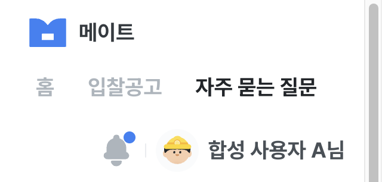

# 설정 및 관리 첫 화면 브라우저 통합 테스트

## 기준

- Figma 파일/화면: [9.0.0 설정 및 관리, 3139:52490](https://www.figma.com/design/Eayi1SWD8Xq8tGBmlp5SV2/%EB%A9%94%EC%9D%B4%ED%8A%B8-v0.0?node-id=3139-52490)
- 구현 화면: `/my`; 연결 확인 대상 `/my/company`, `/my/settings/notifications`, `/auth?mode=login&next=%2Fmy`
- 관련 API: `POST /api/v1/auth/token/refresh`, `POST /api/v1/auth/logout`, `GET /api/v1/me/notification-email-settings`, `GET /api/v1/me/matched-bid-notice-email-settings`
- 이번 작업의 정적 검증: Node 22.20.0에서 `pnpm lint`, `pnpm build`, `git diff --check` 통과
- 실제 브라우저 통합 상태: `2026-09-28 당시 7건 통과`; 회사 메뉴 활성화 후 MSET-02 재확인 대기

## 실행 환경 기록

| 실행일시 | 프론트 URL·배포/commit | 백엔드 URL·배포 | 브라우저·화면 크기 | 테스트 계정/데이터 별칭 | 수행자 |
| --- | --- | --- | --- | --- | --- |
| 2026-09-28 13:30~13:40 KST | `https://local.mate-bid.com:3000`, 작업 트리 `71a1099` 기반 | `https://api-test.mate-bid.com`, 배포 식별자 미확인 | Chrome, 1920px·390×844·320×700 | 기존 Mate 테스트 계정, 회사 미가입 | Codex |

## 선행 조건·범위

- 로컬 HTTPS 인증서와 백엔드 허용 Origin, Google OAuth 반환 설정이 준비된 환경이다. 공개 Vercel 테스트 사이트는 이번 검증 범위에 포함하지 않았다.
- 회사 메뉴는 `/my/company`로 이동한다. 계정 관리, 서비스 이용안내, 의견 보내기는 `준비 중`으로 비활성 표시한다. `/my` 첫 화면 자체에서는 회사명이나 회사 데이터를 조회하지 않는다.
- `/my` 자체의 새 데이터 조회 API는 없다. 세션 확인 API와 이미 구현된 알림 설정 화면으로의 이동을 실제 백엔드와 검증했다.
- 브라우저에서 화면 캡처를 확인하고 Network 이벤트의 경로·HTTP 상태만 기록했다. 이메일, access token, 쿠키, 응답 본문은 보관하지 않았다.

## 테스트 항목

### MSET-01 — 로그인 상태의 첫 화면

- Figma node: `3139:52490`
- 화면 경로: `/my`
- API: `POST /api/v1/auth/token/refresh`
- 준비 데이터: 기존 Mate 테스트 계정 로그인 세션
- 조작: `/my`를 열고 새로고침한다.
- 예상 결과: 세션 API 200 후 제목·메뉴 6개·카드 3개·의견 배너가 표시된다. 회사명은 임의로 만들지 않는다.
- 상태: `통과`
- 환경/증거: Chrome 1920px, refresh 200. 제목 `x378/y94`, 카드 `x370/y214`, 배너 `x370/y438`로 Figma의 주요 위치와 일치했다.

### MSET-02 — 회사 메뉴 활성화와 미구현 항목 비활성

- Figma node: `3139:52490`
- 화면 경로: `/my`
- API: `없음`
- 준비 데이터: 로그인 세션
- 조작: 회사 메뉴·나머지 미구현 메뉴·계정 관리·서비스 이용안내·의견 보내기 상태를 확인하고 회사 메뉴를 누른다.
- 예상 결과: 회사 메뉴는 `/my/company`로 이동한다. 미구현 메뉴 3개와 의견 보내기 버튼은 disabled이며, 두 카드는 링크가 아니라 `준비 중` 안내를 표시한다.
- 상태: `대기` (회사 메뉴 활성화 이후 재확인 필요)
- 환경/증거: 2026-09-28의 기존 코드에서는 회사 메뉴를 포함한 4개가 disabled였다. 당시 통과 결과는 현재 기대값의 증거로 사용하지 않는다.

### MSET-03 — 알림 설정 카드 이동

- Figma node: `3139:52510`
- 화면 경로: `/my` → `/my/settings/notifications` → `/my`
- API: `GET /api/v1/me/notification-email-settings`, `GET /api/v1/me/matched-bid-notice-email-settings`
- 준비 데이터: 로그인 세션과 기존 설정
- 조작: 알림 설정 카드를 누르고, 해당 화면의 마이페이지 breadcrumb로 돌아온다.
- 예상 결과: 설정 화면으로 이동해 두 조회 API가 200으로 응답하며 `/my` 복귀가 동작한다.
- 상태: `통과`
- 환경/증거: Chrome URL 이동 및 두 GET 200 확인. React 개발 모드의 중복 GET은 같은 결과로 관찰했다.

### MSET-04 — 로그아웃과 비로그인 안내

- Figma node: `3139:52522`
- 화면 경로: `/my` → `/auth?mode=login&next=%2Fmy`
- API: `POST /api/v1/auth/logout`
- 준비 데이터: 로그인 세션
- 조작: 왼쪽 로그아웃을 누르고 비로그인 안내의 로그인 버튼을 누른다.
- 예상 결과: 로그아웃 API 200, `/my`에서 로그인 안내 표시, 로그인 링크가 `/my` 복귀 경로를 보존한다.
- 상태: `통과`
- 환경/증거: Chrome에서 logout 200, 로그인 안내, URL의 `next=%2Fmy` 확인.

### MSET-05 — Google 로그인 뒤 복귀

- Figma node: `3139:52490`
- 화면 경로: `/auth?mode=login&next=%2Fmy` → `/my`
- API: 기존 Google OAuth 및 로그인 세션 완료 API
- 준비 데이터: 기존 Mate 테스트 계정
- 조작: 로그인 화면에서 Google로 로그인을 누른다.
- 예상 결과: OAuth callback 뒤 `/my`로 돌아와 설정 화면이 다시 표시된다.
- 상태: `통과`
- 환경/증거: Chrome에서 `/auth/callback?returnTo=/my`를 거쳐 `/my` 및 로그인 메뉴 표시 확인. OAuth Network 본문이나 계정 식별자는 기록하지 않았다.

### MSET-06 — 모바일 배치

- Figma node: `3139:52490`의 데스크톱 디자인을 모바일로 조정
- 화면 경로: `/my`
- API: `없음` (MSET-01의 세션 유지)
- 준비 데이터: 로그인 세션
- 조작: Chrome viewport를 390×844와 320×700으로 바꿔 메뉴·카드·배너를 확인하고 기본 크기로 복원한다.
- 예상 결과: 세 카드가 한 열로 표시되고 메뉴와 배너를 사용할 수 있으며 가로 넘침이 없다.
- 상태: `통과`
- 환경/증거: 390px에서 문서 너비 375px, 카드 너비 343px; 320px에서 문서 너비 305px, 카드 너비 273px. 브라우저 스크롤바를 제외한 화면 폭을 넘지 않았다.

### MSET-07 — 세션 연결 실패와 재시도

- Figma node: `3139:52490`의 오류 상태 조정
- 화면 경로: `/my`
- API: `POST /api/v1/auth/token/refresh`
- 준비 데이터: 유효한 로그인 cookie, 브라우저에서 해당 요청만 임시 차단
- 조작: refresh 요청을 차단하고 새로고침한 뒤, 차단을 해제해 `다시 시도하기`를 누른다.
- 예상 결과: 연결 실패 동안 로그인 상태 오류가 표시되고, 재시도 후 설정 화면이 복원된다.
- 상태: `통과`
- 환경/증거: Chrome DevTools 요청 차단으로 오류 안내·재시도 버튼 확인; 차단 해제 후 `/my` 설정 화면 복귀. 요청 차단 설정은 제거했다. 실제 서버 5xx 응답은 재현하지 않았다.

## 실행 결과 요약

- 2026-09-28 기존 코드의 통과/실패/차단/대기: `7/0/0/0`. 회사 메뉴 활성화 후 MSET-02는 대기다.
- 남은 범위: 회사 화면은 [my-company.md](./my-company.md)에서 검증한다. 계정 관리·서비스 이용안내·의견 보내기는 준비 중이다.
- 최종 판정: `2026-09-28 기존 /my 첫 화면 범위 통과`; 현재 회사 메뉴는 재확인 전까지 전체 재검증 PASS로 취급하지 않는다.

## 2026-11-13 · DEV-56 공통 헤더 검증

- 범위/승인: [DEV-56 D1/D2와 후속 실제 QA 선택](../development/figma-v01/tasks/DEV-56.md#dev-56-brief). 최초 D3는 실제 QA 자원/범위 제공 후 완료다. 쉬운 설명 뒤 사용자가 ‘추천 방식으로 진행 — 로그인 화면 준비해줘’를 선택했고 Chrome 로컬 주소에서 직접 로그인했다고 회신했다. 일반 실제 동작을 검증하고 준비되지 않은 특수 실제 사례는 미검증으로 남기는 범위다. 업무 데이터·메일·회사/알림 설정을 변경하지 않았다.
- 환경: `DEV56-20261113`, KST; Node22.20.0/Next16.2.9. frontend `dfbaae0`+이번 헤더 diff, header SHA256 `67d5577fe0a9983a79dd40420e31b8ff8d1ba2db037a7d18db5f8877dec8d07e`. API/전체 mock/HTTP 대역의4개 격리 runtime이 같은 소스와 일치한다. 실제 Chrome/합성 Aside에서 desktop1920·390×844·320×700 등을 확인했다. 실제 Chrome mobile document clientWidth는375/305px(스크롤바 제외)이었고 overflow 없음. 브라우저 세부 버전/개별 실제 요청 시각은 미수집이다.
- Figma: [2048:58683 GNB](https://www.figma.com/design/Eayi1SWD8Xq8tGBmlp5SV2/?node-id=2048-58683)·[3139:52491 GNB](https://www.figma.com/design/Eayi1SWD8Xq8tGBmlp5SV2/?node-id=3139-52491).56px·좌우60px·로고/메뉴40px·36px 원형/30px 기존 ceo 아이콘·이름8px 간격·브랜드grayscale800을 확인했다. `mate-brand.svg`/`alarm.svg`/`ceo.svg` 기존 자산의 로드/크기·비율을 확인했다. 미구현 뉴스는 활성화하지 않았다. 상태별 전체 화면 pixel PASS는 아니다.
- 계약: backend dev `befe434c2b3fd80ddbc12c1d6216f738dd5ea12a`의 인증 response와 개발 Swagger3.1.0/v1 nullable nickname 재확인. 명세 SHA256 `30b46f3eca639a412659fe2a18f5908c6695786b4134d8319705dba095197164`. 과거 배포는 [고정 감사](../development/figma-v01/audits/2026-11-13-backend-readiness.md), 이번 서버 process SHA 대응은 미확인이다. 실제 응답 상태를 소스 배포 동일성의 증명으로 올리지 않는다.

### 합성 HTTP 대역 / 전체 mock · HUI-01~17

HTTP 대역은3102→소유 합성 서버4300(auth/notifications만 api·나머지5그룹 mock), 전체 mock은3101이다. 환경파일/실제 OAuth·업무 데이터를 복사하지 않았다.

| ID | 시나리오 | 결과/증거 |
| --- | --- | --- |
| HUI-01 | 정상 이름·아이콘·현재 Q&A 메뉴·알림 양수 | PASS:56px·36/30px·gap8px·grayscale800·이미지 로드·점 표시 |
| HUI-02 | nickname null | PASS: 아이콘만·접근성 이름 ‘설정 및 관리’, 임의 이름/메일 없음 |
| HUI-03 | 공백 이름 | PASS: HUI-02와 동일 |
| HUI-04 | 회사 연결 / 미연결 | PASS: 계정 이름 유지·회사명/별도 조회 없음 |
| HUI-05 | 다른 계정·미확인0 | PASS: B 이름·이전 이름/점 없음 |
| HUI-06 | 세션4초 지연 | PASS: 확인 중만 표시·CTA/이름 없음, 이후 정상 |
| HUI-07 | refresh500 | PASS: 오류/재시도·이름/비로그인 CTA 없음 |
| HUI-08 | 재시도3초 지연/실패 | PASS: busy/disabled·중복 Enter 미제출, 이후 재시도 유지 |
| HUI-09 | 실패 뒤 정상 재시도 | PASS: 이름 복원 |
| HUI-10 | 긴 이름390/320px | PASS: ellipsis·프로필 안쪽·헤더 overflow 없음 |
| HUI-11 | 미확인 건수500 | PASS: 이름 유지·점 숨김·임의 건수 없음 |
| HUI-12 | 프로필 keyboard / `/my` | PASS: Shift+Tab은 알림, Enter는 `/my`·현재 메뉴·기존 logout |
| HUI-13 | logout3초 지연 | PASS: 기존 `/my` 버튼 busy/disabled |
| HUI-14 | logout500 | PASS: 오류/재시도·프로필 유지 |
| HUI-15 | logout 재시도200 | PASS: 프로필/오류/점 제거·비로그인 CTA |
| HUI-16 | logout 뒤 하드 리로드401 | PASS: 비로그인 유지 |
| HUI-17 | 전체 mock 로그인→입찰→리로드→다른 계정 | PASS: 이름 복원·다른 이름 교체·메뉴page·관찰한 외부 브라우저 요청0건 |

대기 helper timeout 뒤 새 snapshot/경로를 확인했다. 첫 비동기 loading을 제품 실패로 확정하거나 추측 수정하지 않았다.17사례 결과를 독립 assertion으로 재확인했다. 늦은 응답/계정 epoch·nullable nickname의 기존 Controller/HTTP 검증은414 tests에 포함되며 실서버 결과와 구분한다.

### 실제 개발 API · HAPI-01~10

`https://local.mate-bid.com:3000`→`https://api-test.mate-bid.com`, api 프로필·이번 소스 격리 runtime. 계정은 기록용 별칭 `LIVE-HEADER-A`만 쓴다. Google 로그인은 사용자 직접 수행. 이름·메일·ID·응답 본문·token/cookie/인증 URL을 출력/캡처/저장하지 않았다. Network 응답 본문은 조회하지 않고 경로/상태만 추출했다. 실제 로그인 뒤 원문 요청이 들어갈 수 있는 소유 Next 임시 로그는 열람 없이 제거하며 프로세스 종료로 열린 출력도 정리한다. Chrome은 인증서 경고 없이 열렸다. Aside 준비 화면의 로컬 인증서 경고/해당 호스트 예외와 구분하고 공개 Google/API 검증을 약화하지 않았다.

| ID | 시나리오 | 결과/실제 관찰 |
| --- | --- | --- |
| HAPI-01 | 사용자 직접 Google 로그인 뒤 헤더 | PASS: `/bids` 이름+아이콘·별도 header logout 없음. OAuth 완료 요청 상태는 미수집 |
| HAPI-02 | 새로고침 세션 복원 | PASS: refresh POST200·헤더 이름 복원 |
| HAPI-03 | 프로필 Enter / `/my`·알림 조회 | PASS: 이동·aria-current page·unread-count GET200(2건), 실제 건수/본문 미보관 |
| HAPI-04 |390/320px·keyboard | PASS: 프로필 안쪽·overflow 없음·Shift+Tab 알림 초점·아이콘 로드 |
| HAPI-05 | 기존 `/my` 로그아웃 | PASS: logout POST200·프로필 제거·로그인 CTA/복귀 안내 |
| HAPI-06 | 로그아웃 뒤 새로고침 | PASS: refresh POST401·비로그인 유지·프로필 없음 |
| HAPI-07 | 이름 결측·회사 연결별 계정 | 미실행: 전용 계정 미제공. HUI-02~04와 구분 |
| HAPI-08 | 실제 refresh/logout 오류·지연/busy | 미실행: 안전한 서버 오류 자원 없음. HUI-06~09/13~15와 구분 |
| HAPI-09 | 실제 계정 교체/늦은 응답 | 미실행: 두 번째 전용 계정/동시 응답 자원 없음. mock/Controller tests와 구분 |
| HAPI-10 | 실제 양수/0/오류의 알림 점 | 미실행: 제어 가능한 fixture 미제공. 일반 조회200만 HAPI-03에 기록 |

실제6사례 PASS는 사용자 허용 일반 흐름의 결과다. 특수4사례 미실행·실행 SHA 미확인을 유지하며 QA-14 전체/MSET-02·다른 QA 차단/진행 예외를 해소하지 않는다. 업무 version/409·회사/메일/문서 변경은 헤더 표시 변경의 영향 밖이다.

### 자동 검증 / 문서·Review Gate

- Node22.20.0 `pnpm test`414/414·`pnpm lint`·`pnpm build` api/mock/hybrid·`pnpm build-storybook` PASS. 격리 symlink·pnpm 자동 설치 오류는 복사본/실행 옵션만 수정해 해결했다. 제품 자동 수정0/3, Source/패키지/의존성 변경 없음.
- 로그/비식별 결과는 저장소 밖 `/tmp/mate-dev56-20261113`에 보관한다. 영속 캡처는 위 합성 이미지뿐이다. 실제 이름 없는 로그아웃 화면도 비식별 결과로 보관했다.
- [Context Audit](../development/figma-v01/reviews/DEV-56-context.md)·[6항목 ai-review/검증](../development/figma-v01/reviews/DEV-56.md)·[Task 최종 Gate](../development/figma-v01/tasks/DEV-56.md#dev-56-verification)를 따른다. Git/CI/병합은 실제 PR/최종 보고로 별도 확인한다.
