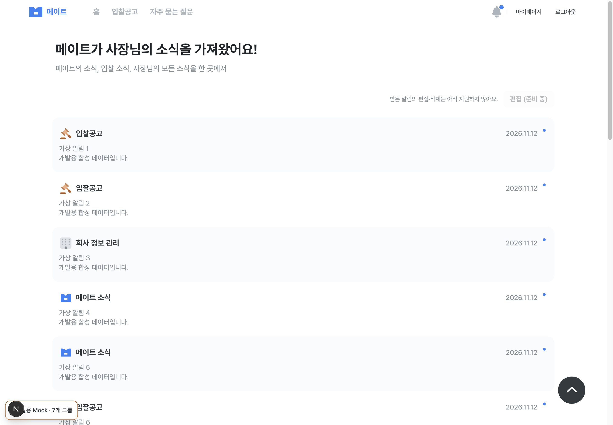
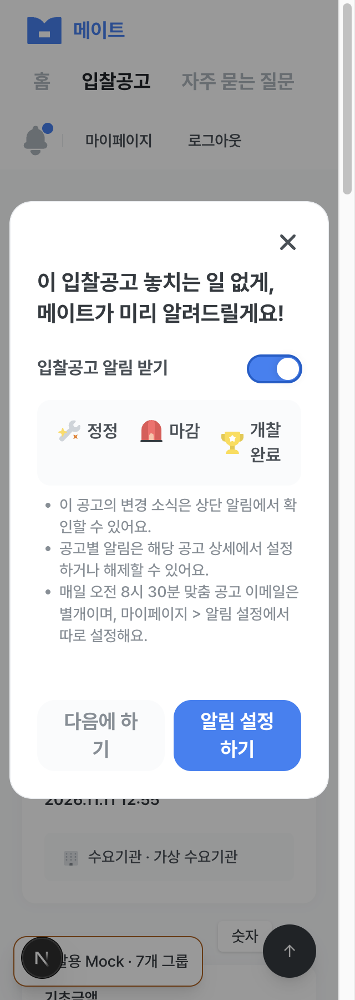
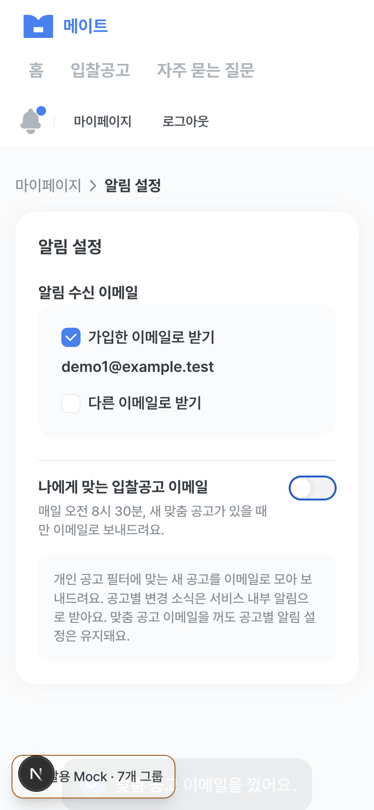

# DEV-62 · 알림 채널/관리 안내 검증

2026-11-12 KST · [Task/Brief](../development/figma-v01/tasks/DEV-62.md#dev-62-brief) · [WBS](../development/figma-v01/README.md) · [Context Audit](../development/figma-v01/reviews/DEV-62-context.md).

## 범위와 근거

- 공고별 내부 알림·08:30 맞춤 이메일·받은 소식 조회/이동·미지원 관리/편집 안내만 교정했다. 데이터/Repository/DTO/mock 계약·URL·활성 조건·삭제/보존 정책은 바꾸지 않았다.
- Figma `2113:19107` 로그인 전 상세와 `2304:29131` 기본 알림의 현재 context/render, 중앙 notification 정책 main `c9e50ff`와 POL-04 v1/DEV-06 source를 대조했다. 전체 frame/pixel 검증·새 화면 예외 승인은 아니다. POL-29 D3/DEV-66의3항목/미지원 disabled 구성은 별도다.
- 현재 backend dev `4c328d4`의 Controller에 삭제 POST가 있다. 개발 OpenAPI의 이번 비인증 GET403과 과거2026-11-11 GET200을 분리한다. 삭제 정책 미확정(POL-20)·프론트 미연결(DEV-43)을 API 부재로 설명하지 않는다. 실행 process SHA·실제 업무 응답은 미확인이다.

## 실행 환경

- 시작 main `9098f469fa74ca9a22803cbc11e1ce5f2d5e0a07`, `fix/dev-62-notification-guidance`. 검증한 runtime4파일과 작업트리 SHA-256 일치 확인.
- Node22.20.0/pnpm11.3.0, 환경파일 없는 격리 source, 실제 Next16.2.9와 Aside Chromium. 화면은1440×1000/320×900/390×844(CSS px), 캡처 DPR2다.
- mock: 전원 mock7그룹·합성 계정1/공고10001. HTTP 대역: auth/notifications/notificationSettings만 loopback4379, bids/bidAlerts/personalFilters/company는 mock. 이는 CI hybrid 빌드 조합과 별개의 브라우저 검증 조합이다.
- 실제 계정 로그인·업무 API 조회/변경·메일 발송·삭제 요청·운영/배포0건. 업무 API의 실제 통합 PASS를 주장하지 않는다.

## 사례와 결과

| ID | 범위/조작 | 결과와 증거 수준 |
| --- | --- | --- |
| NGC-01 | 비로그인 `/alarms` → 로그인 CTA → 합성 로그인/복귀 | mock PASS. 새 ‘받은 알림 확인’ 안내·`next=/alarms`·복귀 확인 |
| NGC-02 | 받은 목록의 편집 미지원 설명 | mock/HTTP 대역 PASS. 버튼 disabled, 화면에 보이는 사유와 `aria-describedby=alarm-edit-help`,390px overflow 없음 |
| NGC-03 | 첫 미읽음 알림 키보드 Enter | mock/HTTP 대역 PASS. mock 미확인22→21·공고10001 이동. 대역 read503은 목록/미확인 유지·오류/재시도,200 복구 후 이동 |
| NGC-04 | 공고 상세 팝업·Space/Enter 설정·새로고침·해제 | mock PASS. 상단 알림/상세 설정·해제/별도08:30 이메일3문구 확인.320px dialog288px·dialog/page 가로 넘침 없음. ON 후 reload 유지·OFF 가능 |
| NGC-05 | 마이페이지 관리 메뉴와 실제 설정 링크 | mock PASS. ‘알림 설정 공고’ disabled·본문 사유, nav의 `aria-describedby=my-menu-help`. 실제 설정 경로 `/my/settings/notifications` 도착 |
| NGC-06 | 맞춤 이메일 Space ON→OFF·공고 구독 확인 | mock PASS. 이메일OFF에도 공고10001 ON 유지, 이후 상세에서 공고OFF 해도 이메일OFF 유지.390px 줄바꿈/가로 넘침 없음. HTTP 대역에서도 새 문구/독립 수신 설정 화면 확인 |
| NGC-07 | 빈 알림 목록 | HTTP 대역 PASS. 빈 상태만 표시하고 편집·없는 관리 목적지를 안내하지 않음 |
| NGC-08 | 목록 GET503 → 오류 해제 → 키보드 재시도 | HTTP 대역 PASS. alert/재시도·로딩 뒤 목록 복구, 원래 읽음 상태 유지 |
| NGC-09 | actionPath null 알림 읽음 | HTTP 대역 PASS. 읽음200 뒤 `/alarms` 유지·이동할 수 있는 화면 없음 status. 실제 API/위험 경로 전체 회귀는 기존 계약 테스트와 DEV-06 QA 범위를 구분 |

mock8개 관찰 묶음·HTTP9개 관찰 묶음을 외부 `mock-evidence.json`/`http-evidence.json`에 보존했다. 위9개 case는 화면 여정별 집계이며315 Node tests나 실제 API case 수와 합산하지 않는다. 키보드·AX snapshot·DOM의 native disabled/설명 연결을 확인했으며 실제 VoiceOver 음성 검증은 미실행이다.

## 자동/문서 검증

| 명령/검사 | 결과 |
| --- | --- |
| `pnpm test` | PASS · Vitest Node315 tests/15파일. 기존 오류/권한/충돌·공급원/계정 경계 회귀. 단순 문구를 그대로 복제하는 새 테스트는 추가하지 않음 |
| `pnpm lint` | PASS |
| API/mock/hybrid Preview `pnpm build` | 세 구성 PASS. hybrid는 CI의 company/notifications/notificationSettings mock 조합 |
| `pnpm build-storybook` | PASS. 공용 AlarmPopup 영향 확인, 기존 chunk size 경고만 있음 |
| 문서 링크/anchor·원본/범위·의존성/상태·Markdown·`git diff --check` | PASS. 최종 수치·검토 freshness는 Task/리뷰 기록에서 확인 |

첫 명령 실행 래퍼는 zsh 예약변수 `status` 때문에 앱 완료 후 exit1이었다. 저장소 밖 래퍼만 교정하고 test/lint/API build를 exit0으로 재확인했다. 제품 자동 수정0/3이며 앱 실패로 취급하지 않는다.

## 네트워크/정리와 남은 검증

- mock/HTTP 대역 브라우저의 외부 요청 관찰0건. HTTP 대역은 loopback22요청(200×20,503×2), 삭제 호출0건이다. Aside는 route()를 지원하지 않아 브라우저 인터셉트/차단 검증으로 세지 않는다.
- 서버 fetch guard가 외부8시도를 차단했다(`api/v1/record`, Next dist-tags 경로). 서버까지 포함한 외부 시도0건은 아니다. 실제 업무 API 호출은 없고 remote 업무 변경으로 복구할 데이터도 없다.
- 소유 Next4370/HTTP 대역4379를 종료했다. 합성 탭·state 정리와 listener 반환을 확인하며 실제 서비스·기존 프로세스는 건드리지 않았다.
- [QA-09](../development/figma-v01/tasks/QA-09.md)의 실제8차단, [QA-11](../development/figma-v01/tasks/QA-11.md)의 실제 재검증8차단·ALARM-04/05 별도 이력, [DEV-06](../development/figma-v01/tasks/DEV-06.md)의 ANAV10차단, [QA-12](../development/figma-v01/tasks/QA-12.md)/[QA-13](../development/figma-v01/tasks/QA-13.md)의 실제1/6차단은 유지한다. source·문서·mock/HTTP 대역을 실제 통합으로 대체하지 않는다.

## 화면 증거

로컬 로그/지문/검사기는 이 대화의 visualization artifact 디렉터리 `dev62/`에 보존한다. 공유 가능한 화면3장은 이 문서와 함께 Git에 포함한다.
