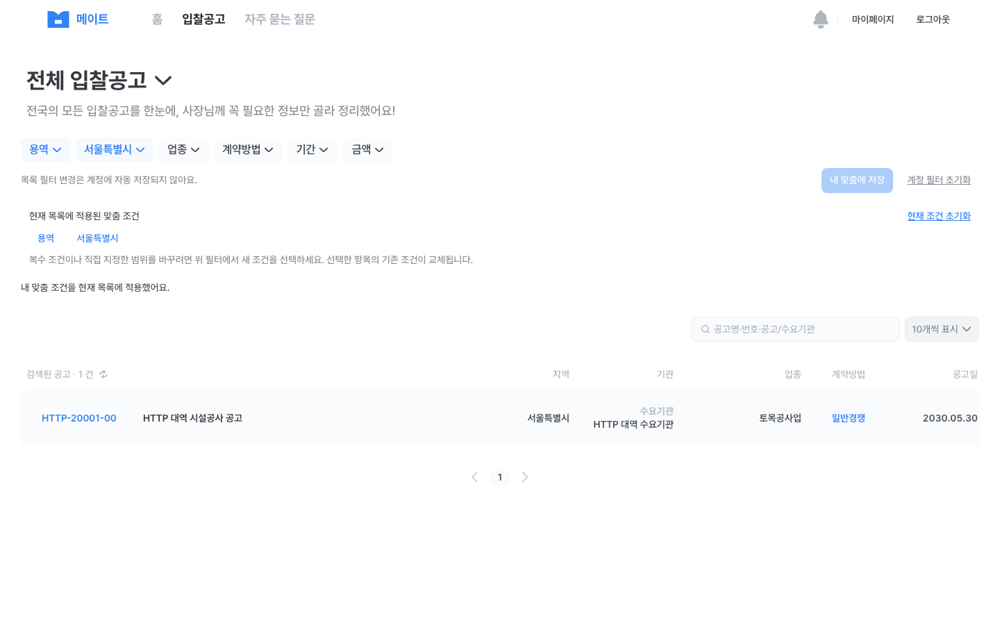
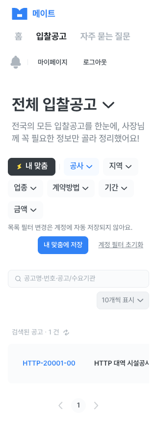

# 개인 맞춤 입찰 필터 브라우저 통합 테스트

## 기준

- Figma: [01_입찰공고리스트 2201:18147](https://www.figma.com/design/Eayi1SWD8Xq8tGBmlp5SV2/%EB%A9%94%EC%9D%B4%ED%8A%B8-v0.1?node-id=2201-18147), ‘내 맞춤’ 적용 2991:111897
- 화면: `/bids?view=all` 또는 `/bids`의 개인 필터 버튼·조건 표시
- API: [테스트 Swagger](https://api-test.mate-bid.com/swagger-ui/index.html)의 `GET|PUT /api/v1/bid-notice-filters/current`, `POST /api/v1/bid-notice-filters/current/reset`, 공개 `GET /api/v1/bid-notices?view=ALL`
- 정책: `mate-docs` ADR-0014. 조회 우선순위 `SAVED > COMPANY_DEFAULT > EMPTY_DEFAULT`, 초기화는 빈 `SAVED` snapshot을 남겨 회사 기본값을 다시 적용하지 않는다. 키워드·목록 view·페이지는 계정 저장 대상이 아니다.
- 구현 범위: 개인 필터 조회·수동 적용·명시적 저장·초기화·버전 충돌. `import-company`와 별도 맞춤공고 목록은 후속 작업.

## 실행 환경

| 실행일시 | 프론트 | 백엔드 | 브라우저 | 계정·데이터 | 수행자 |
| --- | --- | --- | --- | --- | --- |
| 2026-09-28 16:10~16:19 KST | `https://local.mate-bid.com:3000`, 현재 작업 트리 | `https://api-test.mate-bid.com`, 배포 ID 미확인 | Chrome 데스크톱 1920px | 승인된 Mate 테스트 계정, 공개 공고 0건 | Codex |

비밀값, OAuth URL, 쿠키, 토큰, 응답의 개인정보는 기록하지 않는다. 테스트 계정은 처음 `EMPTY_DEFAULT`였고, 저장·초기화 실험 후 **빈 `SAVED` snapshot** 상태가 되었다. 테스트 전 상태로 완전히 되돌리는 API는 없다.

이번 실행에서 관찰한 비식별 API 결과: `GET /current`는 처음 `EMPTY_DEFAULT`를, 저장 후 재조회에서는 `SAVED`를 반환했다. `PUT /current`와 `POST /current/reset`은 변경된 snapshot을 반환했고, 오래된 `expectedVersion`의 `PUT`은 HTTP 409였다. 공개 `GET /bid-notices?view=ALL`은 복수 유형·지역과 금액 조건을 받았지만 결과는 0건이었다. 화면 캡처와 Network 원본 파일은 이번 실행에서 보관하지 않았고 백엔드 배포 식별자도 확보하지 못했다. 아래 관찰 결과는 후속 재검증의 참고 자료이며, 공통 QA 규칙에 필요한 식별자·캡처·비식별 Network 증거를 갖추기 전까지 각 case를 `통과`로 판정하지 않는다.

### 2026-09-29 재검증 시도와 차단 사항

- 08:29~08:37 KST, `https://local.mate-bid.com:3000`의 로컬 개발 서버에서 재시도했다. 프론트 Git 기준점은 `71a109975f12a38ddf6e84a118389308c3321241`이며 **미커밋 작업 트리**이므로 이 SHA만으로 실행 코드를 특정할 수 없다. 맞춤 버튼 파일 `src/components/bids/bid-filter-toolbar.tsx`의 SHA-256은 `91b66ee6f92c793f5cd1e9f46425fcc8e7a852f62c6ec97fa25dd7607f541cde`다. 테스트 백엔드의 배포 식별자는 여전히 확인되지 않았다. GitHub `mate-backend`의 `main` SHA `a12b76ba701e5fea68bffe088239ba7c3c851a65`는 **소스 기준**이지 테스트 서버 배포 버전이 아니다.
- 비로그인 Chrome 1920×872와 Safari에서 `/bids`의 ‘내 맞춤’을 선택하면 `/auth?mode=login&next=%2Fbids`로 이동했다. Chrome 화면은 이번 세션에서 캡처했으나 영구 파일로 보관하지 못했다. 따라서 PBF-01의 공통 증거 요건은 아직 충족하지 못했다.
- Safari에서 ‘Google로 로그인’을 선택하면 Google 계정 선택 화면에 도달하기 전, `GET /api/v1/auth/oauth/google/authorizations?returnTo=%2Fbids`에 `OAUTH_REQUEST_INVALID` JSON이 표시됐다. 같은 시작 endpoint를 직접 HTTP 요청해도 `returnTo` 없음·`%2Fbids`·`/bids` 모두 HTTP 400과 같은 코드였다. 직접 요청은 브라우저 Origin/CORS 검증의 증거로 사용하지 않고, `returnTo` 한 형태만의 문제가 아님을 좁히는 진단으로만 사용한다. Chrome의 별도 자동화 탭에서는 외부 이동이 `ERR_BLOCKED_BY_CLIENT`로 끝났으므로 그 결과로 백엔드 동작을 판정하지 않는다.
- 당시 확인한 [백엔드 `main`의 `GoogleOAuthController.authorize`](https://github.com/mate-pjt/mate-backend/blob/a12b76ba701e5fea68bffe088239ba7c3c851a65/mate-api/src/main/java/kr/co/mate/mate_api/adapter/input/web/auth/oauth/GoogleOAuthController.kt)와 [서비스의 `start` 함수](https://github.com/mate-pjt/mate-backend/blob/a12b76ba701e5fea68bffe088239ba7c3c851a65/mate-api/src/main/java/kr/co/mate/mate_api/application/service/auth/oauth/GoogleOAuthService.kt)에는 이 오류 분기가 없었다. 이후 테스트 배포 브랜치인 `dev`의 MAT-234 변경에서 필수 `returnOrigin` 검증을 확인했으므로, 위 `main` 기반 원인 추정과 서버 로그 선행 요청은 현재 결론이 아니다. 실제 테스트 서버 실행 SHA는 여전히 미확인이다.
- 수정된 프론트로 같은 로컬 HTTPS Chrome에서 Google 신규 가입과 기존 계정 재로그인 후 `/bids?view=recommended` 복귀를 확인했다. OAuth 시작 차단은 해소됐으나 PBF-02~08의 필터 조작 자체는 재실행하지 않았다. PBF-02의 최초 `EMPTY_DEFAULT`는 기존 테스트 계정이 빈 `SAVED` 상태가 되어 재현할 수 없으므로 새 테스트 계정 또는 백엔드 fixture가 필요하다. 각 재실행에는 프론트 코드 식별자, 백엔드 배포 ID, 캡처 파일, 비식별 Network 요약을 함께 남긴다.

## 사례

| ID | 조작과 API | 예상 결과 | 상태·증거 |
| --- | --- | --- | --- |
| PBF-01 | 로그아웃 상태에서 `/bids`의 ‘내 맞춤’ 선택 | `/auth?mode=login&next=%2Fbids`로 이동 | 대기. 9/29 Chrome·Safari 주소 이동 재관찰; 캡처 파일·프론트 실행 식별자 보완 필요 |
| PBF-02 | Google 로그인 후 `/bids` 복귀, `GET /api/v1/bid-notice-filters/current` | 저장 조건이 없으면 `EMPTY_DEFAULT`, 적용 버튼 비활성 | 대기. OAuth 시작 차단 해소; 9/28 관찰 증거 보완 및 새 계정/fixture 필요 |
| PBF-03 | 현재 공사 필터를 ‘내 맞춤에 저장’, `PUT` 후 새로고침 `GET` | `SAVED`가 유지되고 계정 초기화 버튼 표시 | 대기. OAuth 시작 차단 해소; 9/28 관찰 증거 보완 필요 |
| PBF-04 | 저장 조건을 ‘내 맞춤’으로 적용, 공개 `GET /api/v1/bid-notices?view=ALL` | `/bids?personal=1&bidTypes=CONSTRUCTION`, 현재 목록에만 적용 | 대기. OAuth 시작 차단 해소; 9/28 빈 API 결과 관찰 증거 보완 필요. 실제 공고 행 매칭은 PBF-10에서 별도 확인 |
| PBF-05 | 팝업 ‘저장’으로 공사→용역 변경 후 ‘내 맞춤’ 재선택 | 팝업은 계정 PUT 없이 현재 URL만 `SERVICE`로 변경, 재적용 시 계정의 `CONSTRUCTION` 복구 | 대기. OAuth 시작 차단 해소; 9/28 관찰 증거 보완 필요 |
| PBF-06 | 두 유형·두 지역·기초금액 직접 범위가 든 URL을 열고 계정 저장·재조회·적용 | 반복 query와 정확한 금액이 그대로 보존 | 대기. OAuth 시작 차단 해소; 9/28 `CONSTRUCTION`,`SERVICE`,`41`,`48`, 1억~5억 원 재적용 관찰 증거 보완 필요 |
| PBF-07 | 계정 초기화 확인창에서 `POST /reset`, 이후 현재 조건 초기화 | 계정은 빈 `SAVED`, 현재 목록은 초기화 전까지 유지, 별도 초기화로 URL 제거 | 대기. OAuth 시작 차단 해소; 9/28 관찰 증거 보완 필요 |
| PBF-08 | 두 탭이 같은 버전을 읽고 첫 탭이 PUT, 둘째 탭이 오래된 `expectedVersion`으로 PUT | 둘째 탭은 409, 최신 snapshot 재조회, 덮어쓰기 없음 | 대기. OAuth 시작 차단 해소; 9/28 관찰 증거 보완 필요 |
| PBF-09 | 회사 가입 계정에서 `COMPANY_DEFAULT` 읽기·적용·명시적 저장 | GET은 쓰지 않고, 저장 시 `SAVED` 생성 | 대기. 회사 fixture 없음 |
| PBF-10 | 실제 공개 공고가 있는 환경에서 다중 지역·업종·날짜·금액·지역 업체·공동도급 조건 적용 | 목록 행과 총건수가 모든 서버 조건에 일치 | 대기. 테스트 서버 공개 공고 0건. 날짜·지역 업체·공동도급의 실제 서버 매칭도 이때 확인 |
| PBF-11 | 개인 필터 GET/PUT/reset 네트워크 실패와 401, UI 재시도 | 공개 목록은 유지, 개인 필터 오류 안내 및 안전한 재시도 | 대기. 오류 재현 환경 필요 |
| PBF-12 | 390/320px·키보드에서 버튼·조건 칩·초기화 대화상자 조작 | 가로 넘침 없이 조작 가능, 포커스·Escape 확인 | 대기. 데스크톱에서 대화상자 첫 버튼 포커스·Tab 이동·Escape 닫기·원래 버튼 포커스 복귀를 관찰했으나 모바일은 미실행 |

## 범위·후속 작업

- `POST /api/v1/bid-notice-filters/current/import-company`는 회사 계정 fixture 및 덮어쓰기 시나리오를 정한 뒤 연결한다.
- ‘나를 위한 맞춤 입찰공고’ 별도 탭은 대응 목록 API가 확인되면 별도 기능으로 구현한다. 현재 개인 필터는 `view=ALL`에만 수동 적용한다.
- 기존 팝업에서 직접 지정 날짜·금액, 복수 지역·업종, `regionOnly`, `jointContract` 편집은 아직 제공하지 않는다. 서버에서 읽은 해당 값은 목록 조회·재저장 시 보존하고 조건 칩에 모두 표시한다. 완전한 편집 UX는 Figma·정책 확인 후 별도 범위로 진행한다.
- 08:30 맞춤 이메일 내용 반영은 메일 fixture와 다음 발송 시점이 필요해 이 검증에서 제외한다.

## 판정

**0건 통과·12건 대기.** PBF-01~08의 9/28 조회·저장·적용·초기화·충돌 관찰은 공통 QA 증거가 부족해 정식 통과로 기록하지 않는다. 9/29 오전 OAuth 시작 오류를 수정하고 가입·재로그인까지 확인했지만 PBF-02~08 필터 조작은 재실행하지 않았다. PBF-09~12의 회사 기본값·공고 데이터 매칭·오류·모바일은 미실행이다. 재검증 시 백엔드 배포 식별자와 현재 프론트 상태를 특정하고, 화면 캡처 및 비식별 Network 요약을 남긴다.

## QA-10 · 2026-11-04 사전 점검(실제 API 실행 아님)

[작업 기록/재개 조건](../development/figma-v01/tasks/QA-10.md#qa-10-resume) · [검증·검토](../development/figma-v01/reviews/QA-10.md) · [현재/다음/상태는 WBS](../development/figma-v01/README.md).

- 사용자 승인 원문: **“자원 미준비 — 사전 점검·차단 기록·Git 전달만 진행 (추천)”**. 이번 실제 QA는 **0통과·12차단**이다. 위 9월 관찰/0통과·12대기·case ID/예상 결과를 보존한다. QA-04의 인증 승인/결과나 QA-09→QA-10 선정 예외를 실제 필터 변경 승인으로 사용하지 않는다.
- 점검 환경: 2026-11-04 16:38 KST 시작, `qa/qa-10-personal-filter`, source HEAD `345dd87a56224eef234af68cae85ac9b6ed11a7b`(main=origin/main, clean에서 분기). 최종 변경은 사전 점검5문서와 출력 사건 예방 ai-failures를 합한 Markdown6개뿐. Node pin/설치 실행 파일22.20.0·기본 셸26.5.0·pnpm11.3.0, 3000/6006 TCP 리스너 없음. 로컬 HTTPS crt/key는 존재만 확인하고 내용은 읽지 않았다.
- 프론트 실행 snapshot/배포·백엔드 실행 대응은 **미확보**다. 문서상의 대상은 `https://local.mate-bid.com:3000`/`https://api-test.mate-bid.com`이지만 이번에는 접속하지 않았다. 브라우저/화면·캡처·Network·복구 실행은 **해당 없음(앱/실제 API 미실행)**이다. 소스 SHA·과거 인증 PASS·backend 소스 브랜치를 실행 식별자로 대체하지 않는다.
- `src/`·tests·패키지/설정·baseline/coverage/PREP·다른 QA와 기존 QA prefix는 변경하지 않는다. 새 로그인·GET/PUT/reset·fixture 생성·메일·서비스/배포·외부 메시지0회, 새 잔존/복구 대상 없음. 자원 미준비를 현재 공고0건 또는 서비스 장애로 단정하지 않는다.

### 이번 12개 사례의 차단 근거와 재개 조건

화면/Figma·method/endpoint·조작·예상 결과는 위 원래 사례와 기준을 따른다. 아래 표는 **실제 미실행의 준비 판정**이며 소스 대조를 UI/API PASS로 세지 않는다. 담당 역할은 필요한 책임 구분이고 개인 배정은 전부 미확인이다.

| ID | 이번 결과 | 부족한 자원·승인·증거 / 재개 조건 | 필요한 담당 역할 |
| --- | --- | --- | --- |
| PBF-01 | 차단·미실행 | 승인된 로그아웃 브라우저/정확한 HTTPS Origin·현재 프론트 실행 대응과 `/bids`→next 복귀 캡처. 사전 점검 승인으로 새 브라우저/로그인을 시작하지 않음 | 프론트 QA 실행자 |
| PBF-02 | 차단·미실행 | disposable EMPTY_DEFAULT 계정 별칭·최초 snapshot/source/version·로그인/GET 허용·세션 종료 범위. 과거 빈 SAVED 계정을 최초 상태로 취급하지 않음 | 계정 fixture 담당·승인자 |
| PBF-03 | 차단·미실행 | 승인 계정·시작 version·공사 저장 PUT/reload GET 기대값·변경/잔존/종료/복구 범위. 저장 성공과 실제 이메일 반영을 구분 | 필터 API/fixture 담당 |
| PBF-04 | 차단·미실행 | 저장 snapshot·수동 적용 query·ALL 조회 기대 목록/캡처·비식별 Network. 조회의 자동 적용/쓰기 없음과 클릭 적용을 구분 | 필터/공개 공고 fixture 담당 |
| PBF-05 | 차단·미실행 | 승인 계정의 공사 SAVED·팝업 용역 변경·PUT 없이 URL만 변경/다시 공사 적용 기대값. 계정 PUT과 팝업의 현재 목록 ‘저장’ 구분 | 프론트 QA 실행자·필터 fixture 담당 |
| PBF-06 | 차단·미실행 | 두 유형/두 지역·정확한 금액 범위/반복 query·PUT/GET/URL 왕복 기대값과 변경·복구 승인. 과거 코드/금액 관찰을 현재 매칭 fixture로 쓰지 않음 | 필터/공개 공고 fixture 담당 |
| PBF-07 | 차단·미실행 | 시작/종료 snapshot·POST reset/빈 SAVED 잔존 승인·현재 URL 유지 후 별도 초기화·복구 담당/방법. 아래 기존 mock/HTTP 대역 reset 차이도 재개 전 판단 | 필터 API/회사 fixture 담당·승인자 |
| PBF-08 | 차단·미실행 | 승인 계정 두 탭·동일 시작 version·첫 PUT/stale PUT→실제409→최신 GET·덮어쓰기 없음·종료/복구 기대값 | 필터 API 담당·프론트 QA 실행자 |
| PBF-09 | 차단·미실행 | 저장 이력 없는 COMPANY_DEFAULT 계정/회사 조건·GET 무쓰기/명시 PUT→SAVED·이후 잔존/원복 방법. 임의 회사 가입/기본값 생성은 제외 | 회사/필터 fixture 담당·승인자 |
| PBF-10 | 차단·미실행 | 실제 공고 별칭과 유형·지역·업종·날짜·금액·regionOnly/jointContract 포함/제외·총건수/경계 기대값. 과거 공고0건이나 대역 매칭으로 통과 처리하지 않음 | 공개 공고 fixture 담당·백엔드 배포 담당 |
| PBF-11 | 차단·미실행 | 개인 GET/PUT/reset 각각의 안전한 네트워크 실패/해제·실제401/refresh·재시도·오류 후 저장값 기대조건과 승인. 공유 서비스 장애 주입/응답 위조를 실행하지 않음 | 필터/인증 API 담당·프론트 QA 실행자 |
| PBF-12 | 차단·미실행 | 승인 계정·저장 조건·390/320px/키보드와 dialog 포커스/Tab/Escape/복귀·가로 넘침의 캡처/브라우저 버전. 데스크톱 과거 관찰은 모바일 PASS 아님 | 프론트 QA 실행자 |

### reset 계약과 기존 대역의 차이

기존 이 문서의 ADR-0014 인용 정책/예상 결과는 **빈 SAVED**다. 반면 현재 [mock reset](../../src/data/personal-filters/mock-repository.ts)은 `source: "EMPTY_DEFAULT"`·`canImportCompany: false`·증가한 version을 저장하고 [HTTP fetch 대역](../../tests/http-contracts.test.ts)도 reset source를 EMPTY_DEFAULT로 만든다. [mock 계약 테스트](../../tests/account-repositories.test.ts)와 HTTP/mock 공통 테스트는 빈 `filter`만 assert하므로 source·회사 기본값 재적용 방지의 증거가 아니다. 실제 [HTTP 구현](../../src/data/personal-filters/http-repository.ts)은 서버 snapshot을 파싱하며 source를 고쳐 만들지 않는다.

이 차이는 시작 HEAD부터 존재한 **Major 정합성/검증 공백**으로 제한 context-audit **FAIL**에 기록했다. 이번에 mock/대역/실제 API를 재실행하거나 현재 백엔드 정책/응답의 원인을 확정한 것은 아니다. 사전 점검 범위에서 코드/테스트를 바꾸지 않는다. 재개 시 필터 API/정책 소유 역할·개발자가 현재 권위 계약/실제 응답과 수정 범위를 확인하고 source/version/canImportCompany·회사 기본값 억제 검증을 확정해야 한다.

### 잔존·복구와 인계

실제 실행 전 disposable 계정별 시작 source/version/filter와 종료 기대값, PUT/reset·409 허용 범위, 빈 SAVED 잔존/폐기 또는 담당자 fixture 재생성·원복 절차와 검증을 정한다. **reset은 최초 EMPTY_DEFAULT 또는 COMPANY_DEFAULT 복구 수단이 아니다.** 서버에 원상복구 API가 있다고 추정하지 않는다. 회사 기본값 GET과 명시적 저장, 현재 목록 초기화와 계정 reset을 각각 구분한다.

다음 Task는 **QA-10 재개**다. 최신 main/Git·위 조건·현재 프론트/백엔드 실행 대응과 reset 대역 차이부터 확인해 실제 QA Gate를 다시 작성한다. QA-11은 P0 다음 행이나 자체 fixture 차단·QA-10 미검증/진행 예외 없음으로 이번에 선정/착수하지 않는다. import-company·고급 편집·별도 맞춤 목록·실제 이메일 검증은 계속 제외한다. 로컬 앱 test/lint/build/Storybook·mock/HTTP 대역 실행은 Markdown만 변경해 미실행이며, 문서 검사·두 리뷰·원격 head CI 결과는 검토 기록/PR에 구분한다.

### 2026-11-04 16:58 KST · 후속 선정 예외

사용자 [명시 승인](../development/figma-v01/tasks/QA-10.md#qa-10-next-qa-11-exception)으로 위 종료 시점의 ‘다음 QA-10 재개/QA-11 예외 없음’ 중 **다음 작업 선정만 QA-11로 대체**한다. PBF-01~12 실제0통과·12차단과 과거0통과12대기, reset 기대 빈 SAVED 대비 mock/HTTP 대역 EMPTY_DEFAULT의 미해결 Major/context-audit FAIL·재개/복구 조건은 그대로다. 이번 후속은4문서 인계 설명·검증/두 리뷰·Git 전달만 수행한다. QA-11은 새 대화에서 main/Git·해당 task/PREP·ALARM-01~10·승인 계정/알림/읽음 PATCH·시작 건수/정렬/페이지·사용/변경/읽음 잔존/종료/복구·오류/실행 대응부터 확보해 Gate를 작성하며, 실제 fixture 차단·ALARM-04 삭제 API 차단/ALARM-05 7일 안내 보류는 해소되지 않았다. 이번 QA-11 실행·제품 API/데이터/서비스 변경은 없고 QA-10 통합 PASS나 reset 수정, QA-11 실제 실행/운영 승인으로 확대하지 않는다. 검증/리뷰 결과는 [후속 검토](../development/figma-v01/reviews/QA-10.md#qa-10-next-qa-11-review)에 보존한다.

## 2026-11-05 · POL-02 개인 필터와 맞춤 목록의 책임

- [사용자3결정](../development/figma-v01/tasks/POL-02.md#pol-02-approved-decisions): 기존 ALL의 ‘내 맞춤’은 수동 적용을 유지하고, 별도 recommended 진입/reload는 현재 snapshot을 읽어 ALL 자동 조회로 정의한다. 조회 자체로 저장/reset/import·회사 변경을 하지 않는다. query/page/size는 계정 저장 대상이 아니다.
- SAVED > COMPANY_DEFAULT > EMPTY_DEFAULT와 빈 SAVED 보존은 중앙 Accepted ADR-0014를 유지한다. 회사 미연결이어도 유효한 SAVED는 우선하고, 조건이 모두 비면 설정 안내/전체 공고 이동을 제공한다. 빈 조건과 조건은 있으나 매칭0건을 구분한다.
- QA-10 실제0통과·12차단/기존0통과·12대기와 reset 기대 빈 SAVED 대비 mock/HTTP 대역 EMPTY_DEFAULT의 기존 Major/context-audit FAIL은 그대로다. 이번에 코드·테스트·계정·PUT/reset/import 또는 브라우저/업무 API를 실행하지 않았고 새 실제 통과0건이다. 정책 결정으로 reset 차이가 수정된 것은 아니다.
- 후속 [RBD-01~09](bid-list.md#pol-02-recommended-qa)는 DEV-03 이후 검증할 맞춤 목록 사례다. PBF ID/기존 증거와 합치지 않는다. 배포 계약/실행 대응과 차이 처리 범위는 [POL-02 재개 표](../development/figma-v01/tasks/POL-02.md#pol-02-resume), 실제 필터 자원·사용/변경·잔존/복구는 [QA-10 재개 표](../development/figma-v01/tasks/QA-10.md#qa-10-resume)를 따른다.

## 2026-11-09 · POL-07 고급 조건 저장·재조회 QA 인계

- [정책 v1](../development/figma-v01/tasks/POL-07.md#pol-07-contract)·[공통 Gate](../development/figma-v01/tasks/POL-07.md#pol-07-handoff)를 따른다. ALL의 명시적 ‘내 맞춤에 저장’만 계정 snapshot을 바꾸며 팝업 적용은 URL/조회만 변경한다. closing/result 조회와 RESULT 개찰기간·검색어/view/page/size는 계정 저장 대상이 아니다.
- API: 공개 `GET /api/v1/bid-notices?view=ALL`, 보호 `GET|PUT /api/v1/bid-notice-filters/current`, 초기화 회귀 시 `POST /api/v1/bid-notice-filters/current/reset`. POL-07에서 업무 API/로그인/저장/reset은 **실행0건·신규 통과0건**, ADVP4개는 대기다. OpenAPI 열람과 GitHub 배포 기록을 실제 저장/매칭 통과로 세지 않는다.
- 기존 PBF01~12/QA-10의 실제0통과·12차단/기존 대기·reset=EMPTY_DEFAULT Major, POL-02 배포·실제 QA 차단 및 승인 예외는 보존한다. 이번에 새로 확인한 관련 schema/배포 기록을 다른 Task의 전체 재개 조건 충족으로 확대하지 않는다. reset 코드/대역 수정은 별도 범위다.
- 공통 준비: disposable 합성 계정·SAVED/COMPANY_DEFAULT/EMPTY_DEFAULT 초기값/version, 매칭 공고·경계/오류/401/409와 두 계정 경쟁, 사용·PUT/reset 변경·빈 SAVED/이력 잔존·종료/복구 담당/방법, frontend/backend 실행 식별자와 캡처/비식별 Network. 준비는 미확인이고 개인 담당은 지정하지 않았다.

| ID | Figma / 화면 | 조작과 API | 기대 결과 | 상태·근거 |
| --- | --- | --- | --- | --- |
| ADVP-01 | 2991:111897·L07~09 popover / `/bids?view=all` | 고급 조건 팝업 적용→명시적 계정 저장 PUT→GET·재적용 | 적용은 계정 무쓰기; 명시 저장만 expectedVersion과 전체 조건을 보내고 SAVED/source/version 유지 | 대기·미구현/합성 계정/사용·변경·복구 미확인 |
| ADVP-02 | 동일 | 다중 지역·지역Only·공동도급·날짜 종류/절대 범위·정확한 원 금액을 저장·reload | 전체 필드 무손실 왕복·다음 날에도 저장 날짜 고정; closing/result/RESULT 개찰기간·query/view/page/size는 저장되지 않음 | 대기·경계 공고/계정과 실행 대응 필요 |
| ADVP-03 | 동일 | 빈 현재 조건 저장/조회·회사 기본값 비교, 별도 승인된 reset 회귀 | 빈 SAVED는 회사 값으로 되살아나지 않음·GET 무쓰기; URL 전체 해제와 계정 reset은 독립 | 대기·기존 reset Major 미해결, 이번 범위에서 고치거나 PASS로 표시하지 않음 |
| ADVP-04 | 동일 | 잘못된 날짜/금액/지역 결합, 실패/401/409, 로그아웃·계정 교체/늦은 응답 | 오류 입력은 적용/저장 차단·조용한 무시 없음; 충돌 최신값 재조회·무단 덮어쓰기/회사 merge 없음; 타 계정 조건/응답 격리 | 대기·안전한 오류·두 계정·복구 범위 필요 |

다음 첫 행동: DEV-09 Gate에서 공개 지역/공동도급 계약·관련 자료부터 확인하고, 이후 날짜/금액 Task의 검증 범위를 각각 구체화한다. 이 기록은 개발 착수·실제 mutation 승인이나 기존 QA 면제가 아니다.

## 2026-11-12 · DEV-09 지역 저장 Gate 조사 · 실제 실행 없음

- [DEV-09 재개 표](../development/figma-v01/tasks/DEV-09.md#dev-09-gate-handoff)의 개인 저장 계약은 현재 backend dev와 개발 OpenAPI에서 확인했다. ADVP-01/02/04의 지역 저장·reload·오류/계정 수명 부분은 실제 실행0·신규 통과0·Gate 차단이며 현재/다음 Task 상태는 WBS만 소유한다.
- disposable 계정 별칭/초기 snapshot/version·기대 공고·실행 대응·사용/저장 변경/빈 SAVED 잔존/종료·복구·안전한401/409·오류 해제와 이번 로컬 선행 예외 답변은 미확인이다. 계정/비밀값을 읽거나 실제 로그인·GET current/PUT/reset을 실행하지 않았다.
- ADVP4/QA-10/POL-02의 과거 대기·차단/승인 예외를 보존한다. DEV-63의 mock/HTTP 대역 빈 SAVED 교정은 해당 날짜별 기록을 따르며 이 조사에서 실제 reset/매칭 통합이 통과한 것이 아니다. 지역 공개 URL 적용과 계정 명시 저장은 기존 POL-07대로 구분한다.

## DEV-63 · 2026-11-11 reset 로컬 교정과 검증

[작업/계약](../development/figma-v01/tasks/DEV-63.md#dev-63-brief) · [검토](../development/figma-v01/reviews/DEV-63.md) · [WBS](../development/figma-v01/README.md).

- 이전 QA-10의 **실제0통과·12차단**과 9월0통과·12대기·원래 case/승인 예외는 보존한다. 아래 PASS는 새 로컬 reset 교정의 증거이며 PBF 사례를 실제 API 통과로 전환하지 않는다. 과거 EMPTY_DEFAULT Major는 당시 기록이고 아래 교정 이후 mock/HTTP 대역 차이는 해소됐다. 실제 reset 응답·실행 SHA/fixture/사용·변경·잔존·복구 조건은 여전히 미확보다.
- 실행 source: main `121ea30`에서 분기한 `fix/dev-63-personal-filter-reset`의 변경 source. 환경파일 없는 별도 mirror·Node22.20.0/pnpm11.3.0·Next16.2.9. localhost3163은 production mock build, 3164는 api profile Next dev + server/browser HTTP 대역이며 localhost4163 요청은 Playwright가 합성 응답으로 가로챘다. 실제 서버 mutation·OAuth·메일·문서 처리0건이다.
- frame/상태: `/bids`의 [2048:58606](https://www.figma.com/design/Eayi1SWD8Xq8tGBmlp5SV2/?node-id=2048-58606). 이번에는 기존 도구막대/대화상자의 저장/reset 동작만 검증했다. 새 시각 예외·pixel 정합성 승인이 아니며 화면 배치의 후속 소유는 DEV-55다. 새 정책 없이 ADR-0014·POL-02 D2의 빈 SAVED 의미를 교정했다.

| 사례 | 실제 수행/결과 | 근거/한계 |
| --- | --- | --- |
| RESET-L01 | mock/HTTP 공통 저장→reset→재조회, SAVED/version2/빈값·같은 reset replay version 유지, 오래된 reset409 후 최신 저장값 보존 PASS | Node 계약 테스트. HTTP fetch 대역이며 실서버 아님 |
| RESET-L02 | EMPTY_DEFAULT/COMPANY_DEFAULT에서 첫 reset은 SAVED/version1, canImportCompany false/true 보존·Repository 재생성/다른 계정 격리 PASS | 합성 회사 snapshot 주입. 회사 projection/import 구현을 새로 만들지 않음 |
| RESET-L03 | mock409/503/401·reset 도중 계정 교체 및 HTTP401/409/503는 저장값 보존 PASS | HTTP POST/expectedVersion, 401 갱신 후1회 재시도 assertion 포함 |
| RESET-B01 | 실제 Next mock 저장→reset→reload에서 빈 SAVED/version2 안내 유지, URL/목록 조건 유지 PASS | 새 합성 탭. 서버와 브라우저의 실제 API 통합 PASS가 아님 |
| RESET-B02 | 합성 COMPANY_DEFAULT 주입→저장→reset→reload에서 SAVED/version2/canImportCompany=true·회사 기본값 미재적용, 계정2 전환에서 계정1 빈값 보존 PASS | UI에 실제 회사/API가 있다고 추정하지 않음 |
| RESET-B03 | 기존 대화상자의 첫 포커스·Shift+Tab/Tab 순환·Escape/트리거 복귀 및390/320px 가로 넘침 없음 PASS | 실제 Next/Aside 화면. 도구막대 시각 차이의 DEV-55 범위는 그대로 |
| RESET-W01 | 실제 Next + 브라우저 HTTP 대역503/409/401에서 저장 snapshot·URL·dirty 저장 버튼·공개 목록 보존 PASS | 409 재조회 안내, 401 reset2회(갱신 후1회 재시도), 실제 전송0/미정 endpoint0 |

- 자동 검증: 전체187 tests·lint·api/mock/hybrid Preview build PASS. 기존 config/guard·스토리지·계정/DTO/architecture 회귀를 포함한다. shared UI/stories 변경이 없어 build-storybook은 미실행. `git diff --check`와 문서 검사는 Task/검토 기록에서 별도 확인한다.
- 수행 한계/교정: 최초 mirror의 pnpm 의존성 확인·외부 symlink 제한을 기존 의존성 복제로 해결했다. 브라우저 대역의 지역 fixture에 없는 busan query는 목록 오류를 만들어 잘못된 시험 입력임을 확인한 뒤 기본 URL로 바로잡았다. 제품 수정으로 처리하지 않으며 실패를 PASS로 감추지 않는다. Aside 요청 가로채기 미지원으로 오류/네트워크 검증은 Playwright로 전환했다.
- 실제 QA 재개: [QA-10 재개 표](../development/figma-v01/tasks/QA-10.md#qa-10-resume)의 disposable 계정·시작 snapshot/version·매칭 기대값·오류/401/409·업무 API 사용/변경·빈 SAVED 잔존/종료/복구 및 현재 frontend/backend 실행 대응과 승인을 확보한 뒤 PBF-01~12를 별도로 실행한다. 이번 결과로 POL-02 전체/DEV-03·DEV-45를 시작하거나 실제 QA 차단을 면제하지 않는다.

## 2026-11-12 · DEV-55 도구막대 로컬 UI 회귀

- 기준: [POL-29 D1/추가 상태](../development/figma-v01/tasks/POL-29.md#pol-29-decisions), Figma2048:58606/하위2098:65429를 이번에 다시 조회했다. 원본의 왼쪽 어두운 내 맞춤+구분선과 승인된 하단 보조행 예외를 구분한다. 미제공 모바일 frame의 pixel PASS나 헤더/표 등 다른 화면 차이 해소를 주장하지 않는다.
- 실행: frontend 기준 `8d7d656` + DEV-55 미커밋 diff, Node22.20.0/pnpm11.3.0, 환경파일 없는 두 mirror의 runtime3파일 byte 일치. 실제 Next production mock3155/API3156 및 합성 loopback HTTP 대역4155를 사용했다. source commit/배포 문서/실행 프로세스/실제 업무 응답을 혼동하지 않으며 이번은 배포·실제 업무 API QA가 아니다.
- 증거: 저장소 밖 `/Users/jisung/.codex/visualizations/2026/11/12/mate-dev-55/`의 명령 로그·source manifest·mock-final/wire-states/capture-result JSON·PNG. [desktop 캡처](dev-55-toolbar-desktop.png), [320px 캡처](dev-55-toolbar-320.png), [검토 기록](../development/figma-v01/reviews/DEV-55.md).

| 구분 | 조작/기대 | 관찰 결과 |
| --- | --- | --- |
| Figma/배치 | 왼쪽 적용·구분선·하단 오른쪽 저장/reset·안내 | PASS. 높이36px·반경8px·font16px/600·grayscale-800·아이콘16px·구분선1×12px·간격8px. Figma 벡터853bytes를 원래13.3333px 크기로16px slot 중앙 표시 |
| 비로그인/기본값 | 로그인 복귀, EMPTY_DEFAULT·COMPANY_DEFAULT·빈 SAVED | PASS. 비로그인 next=/bids 보존·계정 동작 숨김, 빈 계정 조건 적용 불가·reset 없음, 빈 현재 조건 저장 금지. COMPANY_DEFAULT 비어 있지 않으면 적용/저장 가능하고 일반 조회/적용으로 회사/계정 쓰기 없음 |
| 수동 적용/저장 | 목록 변경·내 맞춤과 명시적 저장을 분리 | PASS. 목록 편집/적용 뒤 저장 snapshot 불변, 명시적 저장 뒤 SAVED1·동일 조건 저장 비활성·dirty면 활성. 기존 적용 후 숨김 조건 유지 |
| loading/busy | 인증/필터 조회 중·저장 중 | HTTP 대역 PASS. 적용/저장 비활성, 저장 중 중복 클릭1회 요청·expectedVersion=null→SAVED1, 기존 source와 안내 보존 |
| 실패/권한/충돌 | GET503→명시 재조회, PUT503/409/401/403, reset409, auth503→명시 재확인 | HTTP 대역13상태+회사 적용/명시저장·403 추가2흐름 PASS. PUT503/409 각1시도·401은 refresh 뒤2시도, expectedVersion3·snapshot/URL 불변·자동 재저장 없음, 충돌 최신값 조회·reset dialog 종료, auth 오류에 계정 쓰기 숨김 |
| reset/reload/계정 | 초기화 뒤 빈 SAVED·원본 계정 격리 | mock PASS. version2 빈 SAVED가 reload 후 유지·회사 기본값 자동 적용 없음, 계정2 EMPTY_DEFAULT/null과 계정1 SAVED2 분리. reset 자체 교정은 DEV-63의 소유 |
| 모바일/키보드 | 320/390px 줄바꿈·도구 순서·Enter/Space·Tab/Shift+Tab·Escape | PASS. 최종 두 viewport 모두 page scrollWidth=viewport, 테이블은 내부 스크롤. dialog 초점 순환/닫기 뒤 초기화 trigger 복귀. 미제공 모바일 원본과1:1 시각 PASS는 아님 |
| view/빈 목록·경계 | ALL 전용 도구·빈 결과·외부 요청 차단 | 최종 mock6흐름 PASS. closing/result에 계정 도구 없음, 빈 결과에도 ALL 도구 유지. 교정 후 브라우저219로컬 요청·업무 API0·외부0·pageerror0, server fetch0. 최종 캡처까지282로컬·외부0. HTTP13상태 종료 시 공통 브라우저 누적 로컬788/대역56·외부0·pageerror0. 추가2흐름도 외부/pageerror0이며 API 구성 서버 전체 fetch71/외부0 |
| 자동 검사 | 실제 package scripts | 187 tests/11files·lint·API/mock/hybrid build·build-storybook·diff-check PASS. 공급원/config/DTO 변경 없음 |
| 실제 API | 기존 PBF-01~12 | **미실행·실제0신규통과/12차단 유지.** 실행 대응·disposable 계정/공고 기대값·업무 변경/잔존/복구/안전한 오류 자원은 기존 QA-10 재개 Gate 필요 |

- 검증 환경 한계/교정: 두 번째 mirror 의존성 복제 완료 전 build의 `next` 미발견은 완료 확인 후 재실행 PASS. 1차 mock 요청 관측 시점과 같은 mirror의 후속 구성 build가 겹쳤으므로 그 결과를 최종 근거로 쓰지 않았다. mock 프로세스를 중지하고 마지막 mock build→새 프로세스/외부 fetch guard→전체6흐름/캡처 순서로 다시 검증했으며 이후 artifact를 수정하지 않았다. 해당 환경 조치2회와 아래 제품 자동 수정1/3을 구분한다. Aside 화면/키보드 검증과 가로채기 미지원으로 보완한 Playwright 관측을 구분한다.
- 기존 실제 QA case·원문·차단·POL-02 미결과 승인 예외는 그대로다. 이 새 로컬 표가 과거 실제 통과/대기/차단을 덮어쓰지 않는다. 소유 mock 공간/브라우저·검증 프로세스 정리는 Task 종료 기록에서 확인한다.

- 1차 독립 verifier FAIL/Major1을 보존한다. 적용 버튼이 rootRef 안으로 이동해 바깥 클릭 닫기가 차단됐고, 실제 Next에서 지역 미저장 draft→내 맞춤 뒤 잔존을 재현했다. render callback으로 close→기존 apply 순서를 명시했다. 교정 후 pointer/Enter/Space3입력에서 닫힘·재개방 draft 폐기·계정 불변 PASS,187 tests/lint·API/mock/hybrid build·Storybook 및 기존 mock6/HTTP13+2/키보드·계정 격리/캡처도 다시 PASS했다. 최종 근거는 `*-corrected-result.json`, `popover-after-result.json`과 `*-corrected.log`/`test-final.log`/`lint-final.log`다. 제품 자동 수정1/3이며 이전 개별 동작 PASS를 이 회귀의 통과로 사용하지 않는다.

## 2026-11-12 · DEV-55 후속 최신 조회·동등성 표시 로컬 QA

기준은 [후속 사용자 결정/Brief](../development/figma-v01/tasks/DEV-55.md#dev-55-followup-brief)다. 클릭마다 최신 GET으로 조회·적용하고 현재 전체 필터가 같으면 숨김/다르면 재표시한다. 별도 ‘내 맞춤에 저장’·reset 의미는 유지하며 적용 버튼의 쓰기는 금지한다. 원본 Figma 2048:58606의 숨김 상태와 사용자 직접 확정을 연결한다. 과거 POL-29/PR54의 ‘기존 표시/핸들러 보존’ 이력은 당시 범위이며 이번 후속 확정으로 대체되는 현재 행동과 구분한다.

- 환경: 환경파일 없는 두 mirror, Node22.20.0/pnpm11.3.0, 실제 Next16.2.9 production server. Node 기본 셸과 저장소 환경파일을 사용하지 않았다. API·mock·hybrid build와213 tests/12files·lint·diff-check PASS. 신규26개는 최신값/중복/실패/빈3source·계정/URL/view/dispose·전체12필드 및 배열 순서/일반 URL 비교다. 기존187개 공급원·guard/계약 회귀도 통과했다.
- 정확한 명령: mirror에서 `pnpm --config.verify-deps-before-run=false test`, `lint`, `build`; build는 `MATE_APP_ENV=preview`와 mock/API/hybrid 구성별 실행이다. hybrid는 company/notifications/notificationSettings만 mock이며 auth/bids/personalFilters는 API다. 실제 Next는 `pnpm start --hostname 127.0.0.1 --port 3155/3156`으로 확인했다. 사전 의존성 검사 해제는 APFS 복제 mirror에서만 적용했고 저장소 설정은 바꾸지 않았다.
- `pnpm build-storybook` 로컬 미실행: 이번 후속은 공유 UI primitive·toolbar·asset·stories·Storybook 설정을 변경하지 않는다. 라우트의 비동기 조회/표시와 controller만 바뀌므로 앱 build/브라우저로 검증했다. 이전 PR54 Storybook PASS를 이번 실행으로 세지 않는다. 원격 CI는 실제 최종 PR head에서 별도 확인한다.
- Aside로 최신 용역/서울 적용 뒤 버튼 숨김과 공사 변경 뒤 재표시를 관찰했다. 요청 가로채기 미지원으로 요청 차단/건수는 Playwright CLI·loopback HTTP 대역으로 보완했다. 업무 API 요청0·외부 요청0·pageerror0이다. HTTP 대역은 실제 백엔드가 아니며 query별 합성 목록 응답으로 SSR 전달을 점검했다.

| 구성/묶음 | 검증한 행동 | 결과 |
| --- | --- | --- |
| API/최신값·비교6 | 화면 snapshot A 이후 서버 B/version7·C/version9 변경, 매 클릭 fresh GET1·snapshot/source/version 반영·숨김. 한 필드 변경/복귀, personal 없는 일반 URL, query/page/size 제외. 조회 중 중복 GET1·별도 쓰기 버튼 비활성 | PASS |
| API/오류6 | GET503/403/401에 현재 URL/조건 유지·기존 값 자동 적용 없음·명시적 재시도에서 최신값 적용. 401은 authorized refresh 후 GET2, 그 외 GET1 | PASS |
| API/빈 조건3 | 최신 EMPTY_DEFAULT/COMPANY_DEFAULT/빈 SAVED는 안내·snapshot만 갱신하고 URL 유지. 이전 empty를 이유로 다음 fresh GET을 막지 않아 새 nonempty 적용 가능 | PASS |
| API/초기 조회 경쟁2 | 느린 초기 A가 fresh B를 덮지 않음. 늦은 초기 성공이 클릭 GET 실패 안내를 지우지 않음 | PASS |
| API/수명5 | RSC1.2초/GET0.4초에서 검색 의도 보존, query 변경 후 history 복귀, ALL→recommended→복귀, logout, 401 refresh의 계정 전환에서 이전 GET 폐기·다음 클릭 가능 | PASS |
| API/키보드3 | pointer/Enter/Space에서 최신 COMPANY_DEFAULT 적용·미저장 draft 즉시 닫힘·재개방 시 폐기·저장 없음 | PASS |
| API/반응형3 | 1440/390/320px에서 표시→숨김→한 필드 변경 재표시, Enter 적용, 버튼 viewport 포함·문서 가로 넘침 없음 | PASS |
| API/unmount1 | Q&A 이동 시 GET 폐기, 재진입 새 클릭 정상 | PASS |
| hybrid/SSR 전달2 | 최신 전체12필드(최솟값0·boolean 포함)가 목록 HTTP query에 전달되고 SERVICE 합성 응답이 화면에 표시됨. GET1·쓰기0·동일 버튼 숨김 | PASS |
| mock8 | 익명 로그인 복귀/빈 최신 조회·별도 명시 저장 후 동일 숨김, pointer/Enter/Space 열린 draft에서 적용 후 storage 불변·숨김, 1440/390/320px 표시/경계·넘침 | PASS |

- 합계: API29+hybrid2의 HTTP 대역31시나리오와 mock8흐름. 필터 적용 흐름에서 PUT/reset/import0건이다. mock의 별도 저장 준비1건을 적용 버튼의 동작으로 세지 않는다. HTTP 합성 auth refresh/logout·fixture control POST는 개인 필터 쓰기와 구분한다.
- 첫 독립 검토의 **Major1/FAIL**: URL commit 전의 탐색 의도 공백을 RSC 지연으로 재현했다. 자동 수정1/3으로 중앙 navigate에서 push 전에 controller를 dispose했다. 교정 후 같은 지연 시나리오와 전체37흐름을 다시 실행했고 hybrid2도 추가 통과했다. 브라우저 스크립트의 view selector role/정확한 이름 오류는 source/snapshot에 맞춰 고친 검사 도구 오류이며 제품 수정 횟수와 구분한다. 최종 review freshness는 후속 검토 기록에서 확인한다.
- 증거: 저장소 밖 `/Users/jisung/.codex/visualizations/2026/11/12/mate-dev-55-followup/`의 build/test/lint exit/log, `wire-core-result.json`(6), `wire-errors-empty-result.json`(11), `wire-lifecycle-result.json`(5), `wire-keyboard-mobile-result.json`(7), `hybrid-list-query-result.json`(2), `mock-ui-result.json`(8), 네트워크 guard 및 교정 전 race 결과. 최종 source manifest/두 mirror byte 일치·문서 보존 검사를 함께 수행한다.

실제 API 통합은 **미실행**이다. QA-10/PBF-01~12의 실제0통과12차단, POL-02 계약 미결과 필요한 계정·배포/실행 대응·사용/변경·잔존/복구·안전한 오류 자원은 보존한다. GitHub source commit·OpenAPI GET200/계약 존재·배포 문서와 실행 중 backend SHA·인증 업무 응답은 별개이며, 이번 결과로 뒤의 두 근거나 통합 PASS를 주장하지 않는다.
